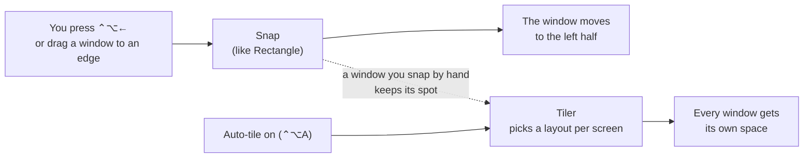
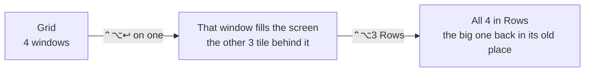
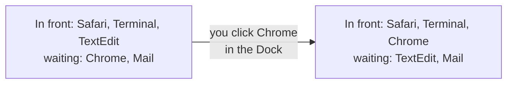
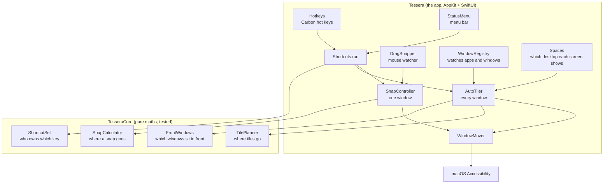

# Tessera

Tessera snaps windows like Rectangle, and can also tile them for you. Auto-tile picks the best layout for the number of windows and the shape of each screen. You can switch layout styles with one key.

It is a menu bar app for macOS 15 or later. It is written in Swift 6 with no outside libraries.

## What it does



You can use snapping alone, exactly like Rectangle. Auto-tile is off until you turn it on.

## First run

1. Unzip `Tessera.zip` and drag **Tessera** into **Applications**.
2. Open it. macOS may say it can't check the app, because it isn't notarized (checked by Apple). Open **System Settings › Privacy & Security**, scroll down, and click **Open Anyway**.
3. Tessera asks for **Accessibility** access. This is how any window manager moves windows. Click **Open System Settings** and turn Tessera on. The window closes by itself when it works.
4. If Rectangle is running, Tessera offers to quit it. Both apps use the same keys, so only one can answer.
5. macOS 15 has its own "drag to a screen edge" tiling, which fights Tessera's. Tessera asks once if it may turn the macOS version off. You can also do it in **System Settings › Desktop & Dock › Drag windows to screen edges to tile**.

> **After an update**, macOS sometimes keeps Tessera's old permission entry. The switch looks on, but nothing moves. Tessera spots this and shows its permission window. Click **Clear the Old Entry**, then turn Tessera on again.

## Keyboard shortcuts

The snap shortcuts are Rectangle's defaults. Change any of them in **Settings**.

| Shortcut | Action | Shortcut | Action |
| --- | --- | --- | --- |
| ⌃⌥← | Left Half (press again: ⅔, then ⅓) | ⌃⌥D | First Third |
| ⌃⌥→ | Right Half (press again: ⅔, then ⅓) | ⌃⌥F | Centre Third |
| ⌃⌥↑ | Top Half | ⌃⌥G | Last Third |
| ⌃⌥↓ | Bottom Half | ⌃⌥E | First Two Thirds |
| ⌃⌥U | Top Left | ⌃⌥T | Last Two Thirds |
| ⌃⌥I | Top Right | ⌃⌥↩ | Maximise |
| ⌃⌥J | Bottom Left | ⌃⌥⇧↑ | Maximise Height |
| ⌃⌥K | Bottom Right | ⌃⌥= / ⌃⌥− | Make Larger / Smaller |
| ⌃⌥⌘→ | Next Display | ⌃⌥C | Centre |
| ⌃⌥⌘← | Previous Display | ⌃⌥⌫ | Restore |

More actions are in the menu with no shortcut yet: Centre Half, Centre Two Thirds, Almost Maximise, Move to Edge, Quarters and Sixths.

**Auto-tile shortcuts** use keys Rectangle doesn't, so the two never clash:

| Shortcut | Action |
| --- | --- |
| ⌃⌥A | Auto-tile on or off |
| ⌃⌥1 … ⌃⌥5 | Auto, Columns, Rows, Grid, Main + Side |
| ⌃⌥L | Next layout style for this screen |
| ⌃⌥⇧L | Previous layout style |
| ⌃⌥M | Swap this window with the main window |
| ⌃⌥W | Float this window (Tessera leaves it alone), or tile it again |
| ⌃⌥Space | Bring a window forward: pick from every window on this desktop |
| ⌃⌥P | Keep this window in front, or let it step back again |

## Snapping with the mouse

Drag a window by its title bar to a screen edge. A blue outline shows where it will go. Let go to snap.

| Drag to | Window goes to |
| --- | --- |
| Left or right edge | Left or right half |
| Top edge | Maximise |
| A corner | That quarter |
| Bottom edge | A third (left, middle or right, by where you are) |

Drag a snapped window away and it gets its old size back.

## Auto-tile

Auto-tile keeps every normal window on a screen arranged. Windows never overlap, and none is ever hidden. Each desktop on each screen has its own layout style.

| Style | What it does |
| --- | --- |
| **Auto** (default) | Picks the best arrangement. 2 windows sit side by side. 3 get a main window plus two stacked. 4 make a 2×2 grid. Portrait screens stack top to bottom. One window on an ultrawide screen is centred, not stretched. |
| Columns | Side by side |
| Rows | One above another |
| Grid | An even grid; the last row widens to fill the gap |
| Main + Side | One big main window; the rest stack beside it. Drag its edge to change its size. |

Each switch shows a picture of the new layout in the middle of the screen. The menu shows the same pictures, drawn for the windows you have open.

**A style you pick keeps its shape.** Some apps won't go below a certain size (Chrome and Safari stop at about 500 points wide). If they can't all fit, say seven windows in Columns, they overlap a little and the picture says so. Auto always looks for an arrangement where everything fits.

How Auto chooses: it tries every grid, plus columns, rows and main + side. It scores each by how close every window is to a comfortable shape (a little wider than tall). The worst window counts extra, so nothing gets squashed into a strip. When an app won't shrink, Tessera notices, gives that window more room, and lets its neighbours share the rest.

**Working with tiles:**

- **New windows** join at the end. Closed windows leave a space that the rest fill.
- **Drag** one tile onto another to swap them. Drag a tile to another screen to move it there.
- **Snap or maximise a window by hand** (⌃⌥←, ⌃⌥↩, or macOS **Window › Fill**) and it keeps that spot. The other windows tile in the rest of the screen. Press **⌃⌥⌫** (Restore) to put it back.
- **Float** a window with ⌃⌥W. Tessera then leaves it where you put it, even when you change layout.
- **Ignore an app** from the menu (**Ignore Safari**, for example). Tessera won't snap or tile it.

**The latest command wins.** Picking a layout (⌃⌥1–5, ⌃⌥L, the menu) or **Retile** puts every window on that desktop into it. A window you snapped or maximised joins again, in its old place. A window in macOS full screen leaves full screen and joins too. Only floating windows (⌃⌥W) stay out.



### Windows in front

Only a few windows sit in front, laid out. The rest wait just off the edge of the screen. So a busy desktop stays tidy, even on a laptop.

**How many:** Auto, the default, shows as many as fit at a comfortable size. That's 3 on a 14- or 16-inch MacBook Pro or a 1920×1080 screen, 2 on a 13-inch MacBook Air, 4 on a 27-inch screen and 6 on an ultrawide. Change it under **Windows in Front** in the menu, or in Settings: 2 to 6, or No Limit.

**Use a waiting window and it comes forward.** Click it in the Dock, ⌘Tab to its app, use ⌘` or Mission Control. It takes the spot of the front window you used least lately, and that one waits instead. The other front windows don't move.



TextEdit was used least lately, so Chrome takes its spot. Safari and Terminal stay exactly where they were.

- **New windows** come to the front, since you just opened them.
- **A closed or minimised front window** leaves its spot to the window you're in next if it was waiting, or else to the waiting window used most lately.
- **Pick by hand:** the top of the menu lists the windows in front and the ones waiting. Click a waiting one to bring it forward. Or press **⌃⌥Space** for the window picker: every window on this desktop, with a number. Press the number (or ↑ ↓ and Return).
- **⌃⌥P keeps a window in front.** It never steps back to make room. You can keep all but one of the front spots, so there's always room for the window you use next.
- **Picking a layout** only rearranges the front windows. Waiting windows stay waiting.
- **Turning auto-tile off, or quitting Tessera,** puts every waiting window back on screen where it last sat. If Tessera ever crashes, the next launch brings any window left off screen back to the middle.

⌃⌥Space is also macOS's shortcut for switching keyboard language when you have more than one. If you use that, give the picker another key in Settings.

**Desktops (Spaces).** Only windows on the desktop you can see take part. Swiping to another desktop never moves a window, so nothing jumps. Each desktop keeps its own layout. A desktop Tessera hasn't seen yet starts with the layout you picked last. A window set to show on every desktop is left alone.

## Settings

Open **Settings…** from the menu (⌘,). It is one page:

- Open at login, and the gap between windows (0–30 points).
- Drag-to-snap, restore size on drag, and size cycling on/off.
- Auto-tile on/off, the layout for each screen, how many windows sit in front, and the main window's share in Main + Side.
- Apps Tessera leaves alone.
- Every keyboard shortcut. Click one and press new keys. Esc cancels; Delete removes it. If a key is taken, it moves to the new action and Tessera tells you.

## For maintainers

### How the code fits together



All the maths lives in **TesseraCore**, which has no AppKit. That is where almost every behaviour change happens, and its tests run in seconds. The app layer only reads windows, moves them, and draws the menu and Settings.

| Folder | What's inside |
| --- | --- |
| `Sources/TesseraCore/Snapping` | `SnapAction` (every action, its title, default shortcut and screen region) and `SnapCalculator` |
| `Sources/TesseraCore/Tiling` | `TilePlanner` (layout styles, Auto's scoring, space left by snapped windows) and `FrontWindows` (the front-window limit: who sits in front, who waits, who steps back) |
| `Sources/TesseraCore/Shortcuts` | Key combos, commands, and the user's shortcut set |
| `Sources/Tessera/Snapping` | Keyboard and mouse snapping |
| `Sources/Tessera/Tiling` | `AutoTiler`: decides which windows to tile and when |
| `Sources/Tessera/Windows` | Window tracking, screens, desktops (`Spaces.swift`), moving windows |
| `Sources/Tessera/UI` | Menu, Settings, the window picker (`WindowPicker.swift`), permission window, overlays |
| `Tests/TesseraCoreTests` | Unit tests for every snap and layout |
| `scripts/` | Build, release, and the real-Mac test (`smoke-test.sh`, `ci/check.py`) |

### How auto-tile stays still

A tiler that moves windows when nothing changed feels broken. Three rules in `AutoTiler` and `WindowMover` stop that:

1. **Only the desktop on screen counts.** During a swipe, windows from two desktops are on screen at once. `Spaces` asks macOS which desktop each window lives on, and the other desktop's windows are left out. While a swipe is still under way, Tessera waits.
2. **A change must be seen twice.** The half-second check acts only when it sees the same new set of windows two times in a row. Brief in-between states never cause a move.
3. **Never ask twice for the same thing.** If a window can't get as small as its tile, `WindowMover` remembers where it ended up. Asking again would only make it jump and come back, so it doesn't.

macOS has no public way to read desktops. `Spaces.swift` uses the window server's own functions, like yabai and Amethyst do. If a future macOS removes them, Tessera still works, and rule 2 keeps it calm.

### How the front-window limit works

All the rules are small functions in `FrontWindows.swift`, with tests in `FrontWindowsTests.swift`. Each one only reorders the list of windows on a screen (the tile order). The first few in the list sit in front; the rest wait. Because the list is the same one swapping and dragging use, those keep working unchanged.

| When | Rule |
| --- | --- |
| A waiting window is used | `bringForward`: it swaps places with the front window used least lately (never a kept one) |
| Windows ask for the front | `arrange`: kept windows first, then new or used ones, oldest wish first; the rest line up most lately used first |
| A front window leaves | `fillSpots`: the window you're in (if waiting), or else the waiting one used most lately, takes its exact spot |
| Any time | `waitingFrame`: waiting windows sit just past a bottom corner, one point on screen, never over another screen |

`AutoTiler` keeps a "last used" number for each window. It goes up whenever you focus a window.

### Build and test

You need Xcode 16 or later (Swift 6).

```bash
swift test                       # unit tests
./scripts/build-app.sh           # debug app   → build/debug/Tessera.app
./scripts/build-app.sh release   # Apple silicon + Intel → build/release/Tessera.app
./scripts/release.sh             # DMG, notarized if NOTARY_PROFILE is set
```

Version, bundle ID and signing live in `scripts/config.env`. With an Apple Developer certificate on your Mac, the build script signs with it. Then macOS keeps the Accessibility permission across updates.

### Common changes

| To change… | Edit |
| --- | --- |
| A default shortcut | `defaultShortcut` in `SnapAction.swift` or `Commands.swift` (layouts too) |
| Where an action puts a window | `region(shape:cycle:)` in `SnapAction.swift` |
| How Auto picks a layout | `score` and `idealAspect` in `TilePlanner.swift` |
| Add a layout style | Add a case to `LayoutStyle`, and its shape in `TilePlanner.frames` |
| Apps ignored by default | `ignoredApps` default in `Settings.swift` |

Add a test in `Tests/TesseraCoreTests` with each change. The `everyWindowGetsItsOwnSpace` test checks every style, 1 to 12 windows, on four screen shapes. `everyStyleKeepsItsShapeWithRealAppSizes` checks each style still has its shape when apps won't shrink.

### Testing on a real Mac

`.github/workflows/tessera-build.yml` runs on GitHub's Macs for every push, on macOS 15 and macOS 26 (Tahoe). It builds, runs the unit tests, then `scripts/smoke-test.sh` opens TextEdit, Finder, Safari, Chrome and Terminal on a 1920×1080 screen and presses the real shortcuts. `scripts/ci/check.py` makes about 520 checks:

- Every snap: each window's exact position against what it should be, and drags to every edge.
- Every layout: picked with ⌃⌥1–5, two full rounds of ⌃⌥L, back again with ⌃⌥⇧L, and clicked in the menu (through Accessibility, as a person would). Each time it checks the layout really has that shape (Columns are side by side and full height, and so on), the windows are where planned, nothing overlaps when it fits, and the second round matches the first.
- With 7, 3 and 1 windows, and while windows open, close, hide and minimise.
- The latest command wins: maximise (Tessera's, and macOS Fill and full screen), then a layout. Every window must join it.
- Desktops: it adds a second desktop, gives it its own layout, then swipes back and forth. It watches every window ten times a second, and fails if any moves.
- Windows in front: with a limit of 3, the other windows wait off screen. It then brings windows forward from their app, the menu and the ⌃⌥Space picker, and checks each one takes the right spot and nothing else moves. It also covers new and closed windows, minimising, ⌃⌥P, Auto, turning auto-tile off and No Limit.

Results and screenshots go to the `tessera-ci` branch (`tessera-ci-latest` for Tahoe).

Two screens: `launch-test.yml` adds a virtual second screen and checks Tessera starts, its menu opens and its keys work. The full layout checks run on one screen.

The test talks to Tessera through a hidden switch that is off by default:
`defaults write com.vikram.Tessera TesseraTestHooks -bool YES`.

## Troubleshooting

| Problem | Fix |
| --- | --- |
| Shortcuts do nothing | Quit Rectangle, Magnet or Spectacle. Then check the menu: a ⚠︎ line means permission is missing or a key is taken. |
| Dragging to an edge snaps with a margin, or twice | That is macOS's own tiling. Menu › **Turn Off macOS Edge Tiling**. |
| Nothing moves after an update | Open the menu › **Allow Accessibility Access…** › **Clear the Old Entry**, then turn Tessera on again. |
| A window won't shrink into its tile | Some apps have a minimum size. Tessera learns it and picks a layout it fits. If none fits, it stays as small as the app allows. |
| Auto-tile grabs a window you want free | Float it (⌃⌥W) or ignore its app from the menu. |
| One window stays put when you change layout | It is floating. Press ⌃⌥W on it to tile it again. |
| A window seems to have vanished | It's probably waiting just off the screen's edge. Click it in the Dock, ⌘Tab to it, or press ⌃⌥Space. Set **Windows in Front › No Limit** to show every window. |
| See what Tessera is doing | Console app, filter by `com.vikram.Tessera`. |
