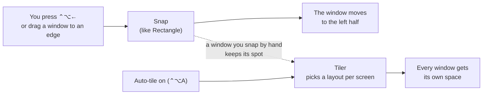
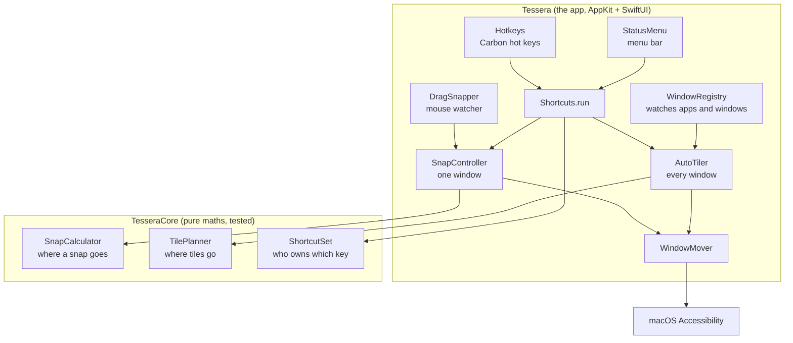

# Tessera

Tessera snaps windows like Rectangle, and can also tile them for you. Auto-tile picks the best layout for the number of windows and the shape of each screen. You can switch layout styles with one key.

It is a menu bar app for macOS 15 or later. It is written in Swift 6 with no outside libraries.

## What it does



You can use snapping alone, exactly like Rectangle. Auto-tile is off until you turn it on.

## First run

1. Unzip `Tessera.zip` and drag **Tessera** into **Applications**.
2. Open it. macOS may say it can't check the app, because it isn't notarized (checked by Apple). Open **System Settings › Privacy & Security**, scroll down, and click **Open Anyway**.
3. Tessera asks for **Accessibility** access. This is how any window manager moves windows. Click **Open System Settings** and turn Tessera on. The window closes by itself when it works.
4. If Rectangle is running, Tessera offers to quit it. Both apps use the same keys, so only one can answer.

> **After an update**, macOS sometimes keeps Tessera's old permission entry. The switch looks on, but nothing moves. Tessera spots this and shows its permission window. Click **Clear the Old Entry**, then turn Tessera on again.

## Keyboard shortcuts

The snap shortcuts are Rectangle's defaults. Change any of them in **Settings**.

| Shortcut | Action | Shortcut | Action |
| --- | --- | --- | --- |
| ⌃⌥← | Left Half (press again: ⅔, then ⅓) | ⌃⌥D | First Third |
| ⌃⌥→ | Right Half (press again: ⅔, then ⅓) | ⌃⌥F | Centre Third |
| ⌃⌥↑ | Top Half | ⌃⌥G | Last Third |
| ⌃⌥↓ | Bottom Half | ⌃⌥E | First Two Thirds |
| ⌃⌥U | Top Left | ⌃⌥T | Last Two Thirds |
| ⌃⌥I | Top Right | ⌃⌥↩ | Maximise |
| ⌃⌥J | Bottom Left | ⌃⌥⇧↑ | Maximise Height |
| ⌃⌥K | Bottom Right | ⌃⌥= / ⌃⌥− | Make Larger / Smaller |
| ⌃⌥⌘→ | Next Display | ⌃⌥C | Centre |
| ⌃⌥⌘← | Previous Display | ⌃⌥⌫ | Restore |

More actions are in the menu with no shortcut yet: Centre Half, Centre Two Thirds, Almost Maximise, Move to Edge, Quarters and Sixths.

**Auto-tile shortcuts** use keys Rectangle doesn't, so the two never clash:

| Shortcut | Action |
| --- | --- |
| ⌃⌥A | Auto-tile on or off |
| ⌃⌥L | Next layout style for this screen |
| ⌃⌥M | Swap this window with the main window |
| ⌃⌥W | Float this window (Tessera leaves it alone), or tile it again |

## Snapping with the mouse

Drag a window by its title bar to a screen edge. A blue outline shows where it will go. Let go to snap.

| Drag to | Window goes to |
| --- | --- |
| Left or right edge | Left or right half |
| Top edge | Maximise |
| A corner | That quarter |
| Bottom edge | A third (left, middle or right, by where you are) |

Drag a snapped window away and it gets its old size back.

## Auto-tile

Auto-tile keeps every normal window on a screen arranged. Windows never overlap, and none is ever hidden. Each screen has its own layout style.

| Style | What it does |
| --- | --- |
| **Auto** (default) | Picks the best arrangement. 2 windows sit side by side. 3 get a main window plus two stacked. 4 make a 2×2 grid. Portrait screens stack top to bottom. One window on an ultrawide screen is centred, not stretched. |
| Columns | Side by side |
| Rows | One above another |
| Grid | An even grid; the last row widens to fill the gap |
| Main + Side | One big main window; the rest stack beside it. Drag its edge to change its size. |

How Auto chooses: it tries every grid, plus columns, rows and main + side. It scores each by how close every window is to a comfortable shape (a little wider than tall). The worst window counts extra, so nothing gets squashed into a strip. Some apps can't shrink past a certain size; Tessera notices and picks an arrangement they fit.

**Working with tiles:**

- **New windows** join at the end. Closed windows leave a space that the rest fill.
- **Drag** one tile onto another to swap them. Drag a tile to another screen to move it there.
- **Snap a window by hand** (say ⌃⌥←) and it keeps that spot. The other windows tile in the rest of the screen. Press **⌃⌥⌫** (Restore) to put it back.
- **Float** a window with ⌃⌥W. Tessera then leaves it where you put it.
- **Ignore an app** from the menu (**Ignore Safari**, for example). Tessera won't snap or tile it.

## Settings

Open **Settings…** from the menu (⌘,). It is one page:

- Open at login, and the gap between windows (0–30 points).
- Drag-to-snap, restore size on drag, and size cycling on/off.
- Auto-tile on/off, the layout for each screen, and the main window's share in Main + Side.
- Apps Tessera leaves alone.
- Every keyboard shortcut. Click one and press new keys. Esc cancels; Delete removes it. If a key is taken, it moves to the new action and Tessera tells you.

## For maintainers

### How the code fits together



All the maths lives in **TesseraCore**, which has no AppKit. That is where almost every behaviour change happens, and its tests run in seconds. The app layer only reads windows, moves them, and draws the menu and Settings.

| Folder | What's inside |
| --- | --- |
| `Sources/TesseraCore/Snapping` | `SnapAction` (every action, its title, default shortcut and screen region) and `SnapCalculator` |
| `Sources/TesseraCore/Tiling` | `TilePlanner` (layout styles, Auto's scoring, space left by snapped windows) |
| `Sources/TesseraCore/Shortcuts` | Key combos, commands, and the user's shortcut set |
| `Sources/Tessera/Snapping` | Keyboard and mouse snapping |
| `Sources/Tessera/Tiling` | `AutoTiler`: decides which windows to tile and when |
| `Sources/Tessera/Windows` | Window tracking, screens, moving windows |
| `Sources/Tessera/UI` | Menu, Settings, permission window, overlays |
| `Tests/TesseraCoreTests` | Unit tests for every snap and layout |
| `scripts/` | Build, release, and the real-Mac test (`smoke-test.sh`, `ci/check.py`) |

### Build and test

You need Xcode 16 or later (Swift 6).

```bash
swift test                       # unit tests
./scripts/build-app.sh           # debug app   → build/debug/Tessera.app
./scripts/build-app.sh release   # Apple silicon + Intel → build/release/Tessera.app
./scripts/release.sh             # DMG, notarized if NOTARY_PROFILE is set
```

Version, bundle ID and signing live in `scripts/config.env`. With an Apple Developer certificate on your Mac, the build script signs with it. Then macOS keeps the Accessibility permission across updates.

### Common changes

| To change… | Edit |
| --- | --- |
| A default shortcut | `defaultShortcut` in `SnapAction.swift` or `Commands.swift` |
| Where an action puts a window | `region(shape:cycle:)` in `SnapAction.swift` |
| How Auto picks a layout | `score` and `idealAspect` in `TilePlanner.swift` |
| Add a layout style | Add a case to `LayoutStyle`, and its shape in `TilePlanner.frames` |
| Apps ignored by default | `ignoredApps` default in `Settings.swift` |

Add a test in `Tests/TesseraCoreTests` with each change. The `everyWindowGetsItsOwnSpace` test checks every style, 1 to 12 windows, on four screen shapes.

### Testing on a real Mac

`.github/workflows/tessera-build.yml` runs on GitHub's Macs for every push. It builds, runs the unit tests, then `scripts/smoke-test.sh` opens TextEdit, Finder, Safari and Chrome and presses the real shortcuts. `scripts/ci/check.py` checks each window's exact position against what it should be, drags windows to edges, and checks every auto-tile style for overlaps and hidden windows. Results and screenshots go to the `tessera-ci` branch.

The test talks to Tessera through a hidden switch that is off by default:
`defaults write com.vikram.Tessera TesseraTestHooks -bool YES`.

## Troubleshooting

| Problem | Fix |
| --- | --- |
| Shortcuts do nothing | Quit Rectangle, Magnet or Spectacle. Then check the menu: a ⚠︎ line means permission is missing or a key is taken. |
| Nothing moves after an update | Open the menu › **Allow Accessibility Access…** › **Clear the Old Entry**, then turn Tessera on again. |
| A window won't shrink into its tile | Some apps have a minimum size. Tessera learns it and picks a layout it fits. If none fits, it stays as small as the app allows. |
| Auto-tile grabs a window you want free | Float it (⌃⌥W) or ignore its app from the menu. |
| See what Tessera is doing | Console app, filter by `com.vikram.Tessera`. |
