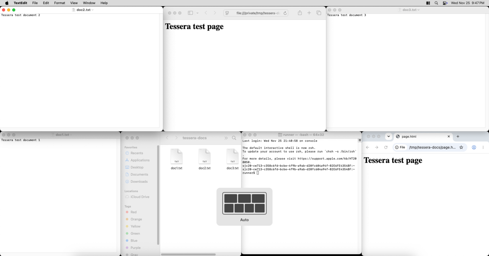
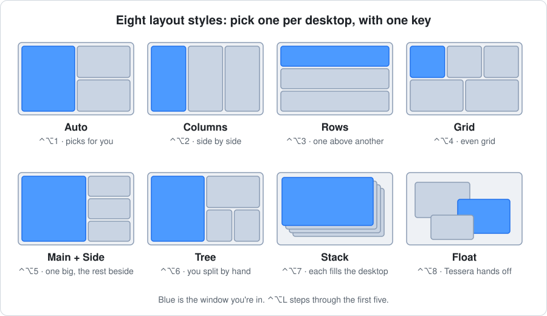

<p align="center">
  
</p>

<h1 align="center">Tessera</h1>

<p align="center">
  <b>Snap windows like Rectangle. Tile them like Shoji. Split them like AeroSpace.</b><br>
  One free menu bar app for macOS, with a command line tool for scripts and AI agents.
</p>

<p align="center">
  <a href="https://github.com/vik101/Tessera/releases/latest"></a>
  <a href="https://github.com/vik101/Tessera/actions/workflows/tessera-build.yml"></a>
  
</p>

<p align="center">
  <a href="#install">Install</a> ·
  <a href="docs/getting-started.md">Getting started</a> ·
  <a href="docs/README.md">Docs</a> ·
  <a href="docs/shortcuts.md">Shortcuts</a> ·
  <a href="docs/cli.md">Command line</a> ·
  <a href="CHANGELOG.md">What's new</a>
</p>

<p align="center">
  
</p>

## What it does

| | |
| --- | --- |
| **Snap one window** | ⌃⌥← puts a window in the left half; drag it to an edge and it snaps. Every action in Rectangle's free version, with Rectangle's keys. [Snapping →](docs/snapping.md) |
| **Tile every window** | Press ⌃⌥A and every window gets its own space. **Auto** picks the best layout for the number of windows and the screen. A busy laptop stays calm: a few windows sit in front, the rest wait just off the edge. [Auto-tile →](docs/auto-tile.md) |
| **Split by hand** | The **Tree** layout works like AeroSpace and i3: join, move, swap, resize, accordion. Switching to it moves nothing. [The Tree layout →](docs/tree.md) |
| **Script it** | `tessera list-windows --json`, `tessera focus left`. Every command, from a shell, a launcher or an AI agent. [Command line tool →](docs/cli.md) |

<p align="center">
  
</p>

**Also:** your real macOS desktops, never fake ones · each screen keeps its own layout, and gets its windows back when you plug it in again · [app rules and setups](docs/rules-and-setups.md) · a [config file](docs/config.md) that reads AeroSpace's · windows waiting off screen come back when you quit.

## Install

Needs macOS 15 or later.

```bash
brew tap vik101/tessera https://github.com/vik101/Tessera
brew install --cask vik101/tessera/tessera
```

Or download `Tessera.zip` from the [latest release](https://github.com/vik101/Tessera/releases/latest) and drag **Tessera** into **Applications**. It isn't notarized by Apple yet, so the first time, macOS asks you to allow it in **System Settings › Privacy & Security**. [Getting started](docs/getting-started.md) walks you through it.

## Try it in a minute

| Press | And |
| --- | --- |
| ⌃⌥← | The window fills the left half. Again: ⅔, then ⅓. |
| ⌃⌥A | Auto-tile turns on: every window gets a spot |
| ⌃⌥1 … ⌃⌥8 | Auto, Columns, Rows, Grid, Main + Side, Tree, Stack, Float |
| ⌃⌥Space | Pick any window to bring forward |
| ⌃⇧⌘ + arrow | Focus the window that way |

⌃ is Control, ⌥ is Option. [Every shortcut](docs/shortcuts.md) is on one page.

## For scripts and AI agents

```bash
tessera list-windows --json                 # ids, apps, titles, screens, desktops, frames
tessera --window-id 1234 send-to-desktop 2  # act on one window
tessera 'layout tree; join right'           # chain commands
tessera subscribe focus-changed             # one JSON line per event
```

Exit codes say what happened: 0 done, 1 failed, 2 Tessera isn't running, 3 typo. See the [command line tool](docs/cli.md) and the [command reference](docs/commands.md).

## Coming from another app?

Tessera reads Rectangle's links, AeroSpace's config and commands, and Spacetile's command names. [Coming from another app](docs/coming-from.md) maps what you know to where it is in Tessera.

## Docs

- **Guides:** [Getting started](docs/getting-started.md) · [Snapping](docs/snapping.md) · [Auto-tile](docs/auto-tile.md) · [The Tree layout](docs/tree.md) · [Desktops and screens](docs/desktops-and-screens.md) · [Rules and setups](docs/rules-and-setups.md)
- **Reference:** [Every shortcut](docs/shortcuts.md) · [Config file](docs/config.md) · [Command line tool](docs/cli.md) · [Command reference](docs/commands.md) · [Links and settings files](docs/links.md)
- **Help:** [Coming from another app](docs/coming-from.md) · [Troubleshooting](docs/troubleshooting.md)

## Status

Tessera 3.0 is new and has one maintainer. Every push is built and tested on GitHub's Macs, on macOS 15 and macOS 26: unit tests, then about 880 checks that press real keys and drag real windows. Two limits to know: releases aren't notarized by Apple yet, and Tessera uses private macOS calls to read desktops (as yabai and Amethyst do), which a macOS update could change.

## Contributing

Bug reports and pull requests are welcome. See [Contributing](CONTRIBUTING.md) and [Developing Tessera](docs/development.md).
