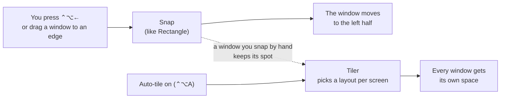
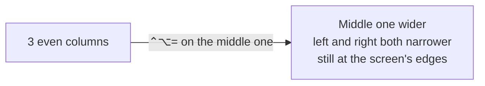
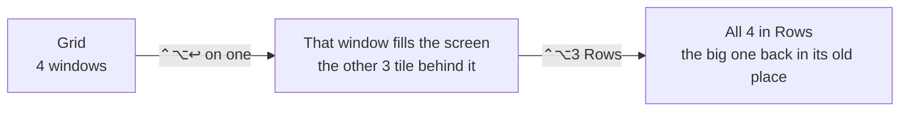
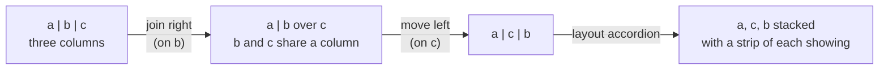
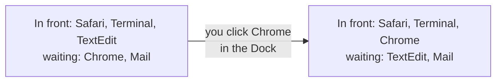
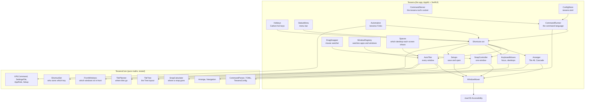
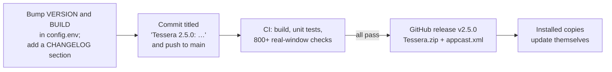

# Tessera

Tessera snaps windows like Rectangle, and can also tile them for you. Auto-tile picks the best layout for the number of windows and the shape of each screen. Or pick the Tree layout and split windows by hand, like AeroSpace and i3. You can switch layout styles with one key.

Power users get a config file (TOML, the same shape as AeroSpace's) and a `tessera` command line tool. The tool lists windows as JSON and runs any command, so scripts and AI agents can drive Tessera.

It is a menu bar app for macOS 15 or later, written in Swift 6. Its one outside library is Sparkle, which installs updates.

## What it does



You can use snapping alone, exactly like Rectangle. Auto-tile is off until you turn it on.

## Install

With Homebrew:

```bash
brew tap vik101/tessera https://github.com/vik101/Tessera
brew install --cask vik101/tessera/tessera
```

Or download `Tessera.zip` from the [latest release](https://github.com/vik101/Tessera/releases/latest), unzip it and drag **Tessera** into **Applications**.

**Updates.** Tessera checks for a new version once a day and asks before installing it. **Check for Updates…** in the menu checks now. Turn daily checks off in **Settings › General**. Every update is checked against Tessera's signing key before it installs.

## First run

1. Install Tessera (above).
2. Open it. macOS may say it can't check the app, because it isn't notarized (checked by Apple). Open **System Settings › Privacy & Security**, scroll down, and click **Open Anyway**.
3. Tessera asks for **Accessibility** access. This is how any window manager moves windows. Click **Open System Settings** and turn Tessera on. The window closes by itself when it works.
4. If Rectangle is running, Tessera offers to quit it. Both apps use the same keys, so only one can answer.
5. macOS 15 has its own "drag to a screen edge" tiling, which fights Tessera's. Tessera asks once if it may turn the macOS version off. You can also do it in **System Settings › Desktop & Dock › Drag windows to screen edges to tile**.

> **After an update**, macOS sometimes keeps Tessera's old permission entry. The switch looks on, but nothing moves. Tessera spots this and shows its permission window. Click **Clear the Old Entry**, then turn Tessera on again.

## Keyboard shortcuts

The snap shortcuts are Rectangle's defaults. Change any of them in **Settings**.

| Shortcut | Action | Shortcut | Action |
| --- | --- | --- | --- |
| ⌃⌥← | Left Half (press again: ⅔, then ⅓) | ⌃⌥D | First Third |
| ⌃⌥→ | Right Half (press again: ⅔, then ⅓) | ⌃⌥F | Centre Third |
| ⌃⌥↑ | Top Half | ⌃⌥G | Last Third |
| ⌃⌥↓ | Bottom Half | ⌃⌥E | First Two Thirds |
| ⌃⌥U | Top Left | ⌃⌥T | Last Two Thirds |
| ⌃⌥I | Top Right | ⌃⌥↩ | Maximise |
| ⌃⌥J | Bottom Left | ⌃⌥⇧↑ | Maximise Height |
| ⌃⌥K | Bottom Right | ⌃⌥= / ⌃⌥− | Make Larger / Smaller |
| ⌃⌥⌘→ | Next Display | ⌃⌥C | Centre |
| ⌃⌥⌘← | Previous Display | ⌃⌥⌫ | Restore |

With auto-tile on, the four arrow keys move a tiled window through the layout instead (see [Auto-tile](#auto-tile)).

More actions are in the menu with no shortcut yet: Centre Half, Centre Two Thirds, Almost Maximise, Centre Prominently (centred, a little high), Specified Size (1680 × 1050 points unless you change it in Settings), Move to Edge, Quarters, Sixths, Corner Thirds (two thirds wide, half high), Eighths and Ninths. With these, Tessera has every single-window action in Rectangle's free version. Give any of them a key in Settings, or run it from a script (see [Scripts and links](#scripts-and-links)).

**Auto-tile shortcuts** use keys Rectangle doesn't, so the two never clash:

| Shortcut | Action |
| --- | --- |
| ⌃⌥A | Auto-tile on or off |
| ⌃⌥1 … ⌃⌥5 | Auto, Columns, Rows, Grid, Main + Side |
| ⌃⌥6 ⌃⌥7 ⌃⌥8 | Tree, Stack, Float |
| ⌃⌥L | Next layout style for this screen (Auto to Main + Side) |
| ⌃⌥⇧L | Previous layout style |
| ⌃⌥M | Swap this window with the main window |
| ⌃⌥W | Float this window (Tessera leaves it alone), or tile it again |
| ⌃⌥Space | Bring a window forward: pick from every window on this desktop |
| ⌃⌥P | Keep this window in front, or let it step back again |

**Moving around** (also keys Rectangle doesn't use):

| Shortcut | Action |
| --- | --- |
| ⌃⇧⌘ ← → ↑ ↓ | Focus the window to the left, right, above or below, on any screen |
| ⌃⌥⇧1 … ⌃⌥⇧9 | Send this window to desktop 1 … 9 on its screen |
| ⌃⌥⌘1 … ⌃⌥⌘9 | Open saved setup 1 … 9 |

## All windows at once

The menu's **All Windows** list has Rectangle's actions that move every window on the screen you're working on:

| Action | What it does | With auto-tile on |
| --- | --- | --- |
| Tile All | A near-square grid; the last row has fewer, wider windows | Picks Grid |
| Tile in Rows / Columns | Up to 3 rows (or columns); more windows share them | Picks Rows / Columns |
| Cascade All / This App | Each window 30 points down and right of the one behind | Not available (it would undo the tiles) |
| Reverse All | Mirrors every window left to right | Reverses the order of the tiles |
| Next / Previous Stacked Window | Brings forward the next window sitting on the same spot | Works on windows you snapped to one spot |

## Focus and desktops

**⌃⇧⌘ + arrow** moves the focus to the next window that way. It prefers a window in line with yours, then the nearest. Windows waiting off screen are skipped.

**⌃⌥⇧ + number** sends the window you're in to that desktop on its screen, and macOS shows that desktop. macOS has no way for one app to move another app's window to a desktop. So Tessera does what you would do by hand: it holds the window by its title bar and presses **Move right a space** (⌃→) or **Move left a space** (⌃←), then puts the pointer back. Those two macOS shortcuts must be on (System Settings › Keyboard › Keyboard Shortcuts › Mission Control). They are on unless you turned them off.

**Desktop commands** (for the config file and the command line): `desktop 3`, `desktop next`, `desktop prev`, `desktop last` (the one you were on before). `send-to-desktop 2` sends the window and takes you with it. AeroSpace's `move-node-to-workspace 2` sends it and you stay. Tessera's "workspaces" are your macOS desktops, numbered from 1 on each screen. For `desktop 3` to be instant, turn on **Switch to Desktop 3** in System Settings › Keyboard › Keyboard Shortcuts › Mission Control. Without it, Tessera steps there one desktop at a time.

## App rules

A rule tells Tessera what to do with one app's windows, every time. Set rules from the menu (**Rules for Safari ▸**, for the app in front) or in **Settings › App Rules**.

| Rule | What it does |
| --- | --- |
| Always Float | Auto-tile leaves the app's windows where you put them. Snapping still works. |
| Always Keep in Front | The app's windows never step back to wait, while at least one front spot stays free. |
| New Windows Open On | The app's new windows move to that screen as they open. |

## Setups

A setup remembers which apps are on your screens and where their windows are. **Setups ▸ Save Current Setup…** in the menu saves one. Open it from the same menu, or with ⌃⌥⌘1–9 (by its place in the list).

Opening a setup starts any of its apps that aren't running, hides the apps that aren't in it (they keep running; switch this off per setup in Settings), and puts each window back on its screen and in its place. Places are saved as shares of the screen, so a setup also works on a screen of another size. With auto-tile on, each screen also gets the layout it had.

## Scripts and links

Anything Tessera does can run from a script, a launcher or the Shortcuts app, with a link. Links in Rectangle's form work too, so Rectangle scripts carry over.

```bash
open -g "tessera://execute-action?name=left-half"        # any action: Rectangle's names or Tessera's
open -g "tessera://execute-action?name=tile-all"
open -g "tessera://execute-action?name=send-to-desktop-2"
open -g "tessera://execute-layout?name=columns"          # auto, columns, rows, grid, main-and-side
open -g "tessera://execute-task?name=ignore-app&app-bundle-id=com.apple.Safari"
open -g "tessera://save-setup?name=Work"
open -g "tessera://open-setup?name=Work"
open -g "tessera://export-settings?path=$HOME/tessera.json"
open -g "tessera://import-settings?path=$HOME/tessera.json"
```

**Settings files** are plain JSON: shortcuts, layouts, app rules, setups and every switch. **Settings › More** has Export and Import buttons. A file only needs the settings you want to change, for example `{"gap": 8}`. To set up a new Mac, put the file at `~/Library/Application Support/com.vikram.Tessera/TesseraConfig.json` before Tessera's first launch. Tessera reads it once, then renames it with the date.

## Snapping with the mouse

Drag a window by its title bar to a screen edge. A blue outline shows where it will go. Let go to snap.

| Drag to | Window goes to |
| --- | --- |
| Left or right edge | Left or right half |
| Top edge | Maximise |
| A corner | That quarter |
| Bottom edge | A third (left, middle or right, by where you are) |

Drag a snapped window away and it gets its old size back.

## Auto-tile

Auto-tile keeps every normal window on a screen arranged. Windows never overlap, and none is ever hidden. Each desktop on each screen has its own layout style.

| Style | What it does |
| --- | --- |
| **Auto** (default) | Picks the best arrangement. 2 windows sit side by side. 3 get a main window plus two stacked. 4 make a 2×2 grid. Portrait screens stack top to bottom. One window on an ultrawide screen is centred, not stretched. |
| Columns | Side by side |
| Rows | One above another |
| Grid | An even grid; the last row widens to fill the gap |
| Main + Side | One big main window; the rest stack beside it. Drag its edge to change its size. |
| **Tree** | You split windows by hand, like AeroSpace and i3. See [The Tree layout](#the-tree-layout). |
| Stack | Every window fills the desktop, one on top of another. `stack next` steps through them. |
| Float | Tessera leaves every window where you put it. |

Auto, Columns, Rows, Grid and Main + Side keep only a few windows in front (see [Windows in front](#windows-in-front)). Tree, Stack and Float show every window.

Each switch shows a picture of the new layout in the middle of the screen. The menu shows the same pictures, drawn for the windows you have open.

**A style you pick keeps its shape.** Some apps won't go below a certain size (Chrome and Safari stop at about 500 points wide). If they can't all fit, say seven windows in Columns, they overlap a little and the picture says so. Auto always looks for an arrangement where everything fits.

How Auto chooses: it tries every grid, plus columns, rows and main + side. It scores each by how close every window is to a comfortable shape (a little wider than tall). The worst window counts extra, so nothing gets squashed into a strip. When an app won't shrink, Tessera notices, gives that window more room, and lets its neighbours share the rest.

**Working with tiles:**

- **⌃⌥ + arrow walks a window through the layout.** It trades places with the window that way, and every spot keeps its size, so the layout keeps its shape. In Columns, ⌃⌥→ moves it one column right; in Main + Side, ⌃⌥→ on the main window swaps it with the top side window. Past the screen's edge it goes to the next screen that way. (Left Half and the other halves from the menu or a link still snap a window and keep it there.)

- **New windows** join at the end. Closed windows leave a space that the rest fill.
- **Drag** one tile onto another to swap them. Drag a tile to another screen to move it there.
- **Make a tile larger or smaller** with **⌃⌥=** and **⌃⌥−**. It grows into the tiles around it, and they all shrink to make room, so the layout keeps its shape. Or drag the edge between two tiles: that edge stays where you let go, and only the tile on the other side gives way. **⌃⌥⌫** (Restore) evens a tile out again, and picking a layout evens them all out.
- **Snap or maximise a window by hand** (⌃⌥←, ⌃⌥↩, or macOS **Window › Fill**) and it keeps that spot. The other windows tile in the rest of the screen. Press **⌃⌥⌫** (Restore) to put it back.
- **Float** a window with ⌃⌥W. Tessera then leaves it where you put it, even when you change layout.
- **Ignore an app** from the menu (**Ignore Safari**, for example). Tessera won't snap or tile it.

**The latest command wins.** Picking a layout (⌃⌥1–5, ⌃⌥L, the menu) or **Retile** puts every window on that desktop into it. A window you snapped or maximised joins again, in its old place. A window in macOS full screen leaves full screen and joins too. Only floating windows (⌃⌥W) stay out.





### The Tree layout

In Tree, each desktop is a tree of splits. A split runs left to right or top to bottom, and holds windows or more splits. You change the tree with commands. Give them keys in the [config file](#config-file), or run them with the [command line tool](#command-line-tool).



| Command | What it does |
| --- | --- |
| `join left` (and right, up, down) | Puts this window and the one that way into a new split |
| `move left` | Moves the window that way, out of its split if it's at the edge |
| `swap left`, `swap next` | Trades places with that window |
| `preselect down` | The next new window opens below this one |
| `layout tiles vertical`, `layout accordion` | Changes the split this window is in |
| `resize width +100`, `resize smart -50` | Grows or shrinks the window's tile |
| `balance`, `flatten` | Evens out the sizes; or undoes every split |
| `mirror horizontal`, `rotate 90` | Flips or turns the whole tree |
| `zoom` | The window fills the desktop; again, it goes back |
| `float on`, `float off` | Takes the window out of the tree, and back into its old spot |

**Switching to Tree moves nothing.** Tessera reads the tree from where your windows already are. A window you close, minimise or float leaves a hint, so it comes back to the same spot.

**With the mouse:** drag a window onto the middle of another to swap them. Drop it near another window's edge to split that window and sit beside it. Hold **fn** and drag from anywhere inside a window to move it, not only its title bar. (Change the key in Settings › Focus and Look.)

### Windows in front

Only a few windows sit in front, laid out. The rest wait just off the edge of the screen. So a busy desktop stays tidy, even on a laptop.

**How many:** Auto, the default, shows as many as fit at a comfortable size, worked out for each screen on its own. Every window gets at least 500 × 400 points.

| Screen | Windows in front (Auto) |
| --- | --- |
| 49-inch super ultrawide, 34-inch ultrawide | 6 |
| 27-inch | 4 |
| 16- or 14-inch MacBook Pro, 1920×1080, 20-inch 4:3 | 3 |
| 13-inch MacBook Air, 19-inch 5:4 | 2 |

Change it under **Windows in Front** in the menu, or in Settings: 2 to 6, or No Limit.

**Unplugging a screen, or closing the laptop lid.** Tessera remembers what that screen held: its windows in order, which were in front, and its layout. Plug it back in and they go back to it as they were, unless you moved one yourself in the meantime.

**Several screens.** Each screen has its own front windows, limit and layout. Waiting windows hang off a free edge of their own screen, never over another screen, however the screens are arranged. When you plug in, unplug or move a screen, Tessera follows where macOS puts each window, and on each screen the windows you used most lately get the front spots.

**Use a waiting window and it comes forward.** Click it in the Dock, ⌘Tab to its app, use ⌘` or Mission Control. It takes the spot of the front window you used least lately, and that one waits instead. The other front windows don't move.



TextEdit was used least lately, so Chrome takes its spot. Safari and Terminal stay exactly where they were.

- **New windows** come to the front, since you just opened them.
- **A closed or minimised front window** leaves its spot to the window you're in next if it was waiting, or else to the waiting window used most lately.
- **Pick by hand:** the top of the menu lists the windows in front and the ones waiting. Click a waiting one to bring it forward. Or press **⌃⌥Space** for the window picker: every window on this desktop, with a number. Press the number (or ↑ ↓ and Return).
- **⌃⌥P keeps a window in front.** It never steps back to make room. You can keep all but one of the front spots, so there's always room for the window you use next.
- **Picking a layout** only rearranges the front windows. Waiting windows stay waiting.
- **Turning auto-tile off, or quitting Tessera,** puts every waiting window back on screen where it last sat. If Tessera ever crashes, the next launch brings any window left off screen back to the middle.

⌃⌥Space is also macOS's shortcut for switching keyboard language when you have more than one. If you use that, give the picker another key in Settings.

**Desktops (Spaces).** Only windows on the desktop you can see take part. Swiping to another desktop never moves a window, so nothing jumps. Each desktop keeps its own layout. A desktop Tessera hasn't seen yet starts with the layout you picked last. A window set to show on every desktop is left alone.

## Config file

The config file is optional. Without it, Tessera runs from Settings alone. With it, anything the file sets wins over Settings, and the file adds what Settings can't: key bindings, binding modes, window rules, callbacks and gaps for each screen.

It lives at `~/.config/tessera/tessera.toml` (or `~/.tessera.toml`). The menu's **Config and Command Line ▸ Make a Config File** writes one with the main options explained. That file turns on `auto-reload-config`, so Tessera reads it again each time you save. Otherwise run `tessera reload-config`.

```toml
layout = 'tree'                       # the layout for new desktops
preset = 'aerospace'                  # extra keys: tessera, spectacle, aerospace, spacetile, none
on-focus-changed = ['move-mouse window-lazy-center']

[gaps]
inner.horizontal = 10                 # between windows
inner.vertical = 10
outer.left = 20                       # at the screen's edges
outer.top = [{ monitor.'built-in' = 8 }, 20]   # 8 on the laptop screen, 20 elsewhere

[mode.main.binding]
alt-h = 'focus left'
alt-shift-h = 'move left'
alt-r = 'mode resize'                 # a binding mode: other keys until you leave it

[mode.resize.binding]
h = 'resize width -50'                # plain keys work in a mode
l = 'resize width +50'
esc = 'mode main'

[[on-window-detected]]                # a window rule
if.app-id = 'com.apple.calculator'
run = 'layout floating'
```

Settings that aren't in a table (`layout`, `preset`, `on-focus-changed`) must come before the first `[table]`. That's a TOML rule.

**A mistake never stops Tessera.** It keeps the last good config, and the menu says what's wrong and on which line. `tessera config` says the same.

**Coming from AeroSpace?** Tessera reads AeroSpace's settings and commands. **Import AeroSpace Config…** (in the menu or Settings) copies your `aerospace.toml` and lists at the top what won't work here. Any older Tessera file is kept as `tessera.toml.bak`.

## Command line tool

`tessera` runs any command and answers questions, for scripts and AI agents. Install it from the menu: **Config and Command Line ▸ Install Command Line Tool**. With Homebrew it's installed for you.

```bash
tessera list-windows --json            # every window: id, app, title, desktop, screen, state, frame
tessera focus left
tessera --window-id 1234 send-to-desktop 2
tessera layout tree && tessera join right
tessera tree                           # the Tree layout as text: H[1234 V[5678 9012]]
tessera subscribe focus-changed        # one JSON line per event, until you stop it
tessera help resize                    # what a command does, with an example
```

| Exit code | Means |
| --- | --- |
| 0 | It worked |
| 1 | It ran but failed (no such window, nothing to do) |
| 2 | Tessera isn't running |
| 3 | A typo: unknown command or bad argument. The message says why. |

Commands chain with `;`, `&&` and `||`, like a shell. AeroSpace's and Spacetile's command names work too (`workspace 2`, `focus west`). The tool talks to Tessera over a socket only you can open (`/tmp/tessera-<your user id>.sock`).

**Run a setup when an app opens, or at a set time.** Make a Shortcuts automation that runs the shell script `tessera setup open Work`, or opens the link `tessera://run?command=setup%20open%20Work`.

## Coming from AeroSpace or Spacetile

| They have | In Tessera |
| --- | --- |
| Tree tiling: join, split, move, resize, accordion, flatten, balance | The Tree layout, with the same commands |
| Workspaces | Your macOS desktops, numbered 1, 2, 3… on each screen |
| A config file, binding modes, window rules, callbacks | `tessera.toml`, which reads AeroSpace's keys too |
| A command line tool | `tessera`, with JSON output |
| Gaps per screen | `[gaps]` with screen patterns |
| Stack, float, zoom, preselect, drop zones, fn-drag (Spacetile) | All there |
| Dim others, focus border, focus follows mouse | In Settings › Focus and Look. Off until you turn them on. |
| Named workspaces, moving a workspace to another screen, instant hidden switching | Not supported. Tessera uses real macOS desktops, so it never hides windows off screen to fake them. |

## Settings

Open **Settings…** from the menu (⌘,). It is one page:

- Open at login, and the gap between windows (0–30 points).
- Drag-to-snap, restore size on drag, and size cycling on/off.
- Auto-tile on/off, the layout for each screen, how many windows sit in front, and the main window's share in Main + Side.
- Apps Tessera leaves alone, app rules, and saved setups.
- Specified Size, and Export / Import of a settings file.
- Updates: a switch for the daily check.
- Every keyboard shortcut. Click one and press new keys. Esc cancels; Delete removes it. If a key is taken, it moves to the new action and Tessera tells you.
- A key preset (Tessera, Spectacle, AeroSpace, Spacetile or none), and the gap at the screen's edges.
- Focus and Look: dim the other windows, a border around the window you're in, focus follows the mouse, and the key to hold for dragging from anywhere in a window.
- The config file and the command line tool.

## For maintainers

### How the code fits together



All the maths lives in **TesseraCore**, which has no AppKit. That is where almost every behaviour change happens, and its tests run in seconds. The app layer only reads windows, moves them, and draws the menu and Settings.

| Folder | What's inside |
| --- | --- |
| `Sources/TesseraCore/Snapping` | `SnapAction` (every action, its title, default shortcut and screen region) and `SnapCalculator` |
| `Sources/TesseraCore/Tiling` | `TilePlanner` (layout styles, Auto's scoring, space left by snapped windows) and `FrontWindows` (the front-window limit: who sits in front, who waits, who steps back) |
| `Sources/TesseraCore/Shortcuts` | Key combos, commands, and the user's shortcut set |
| `Sources/TesseraCore/Automation` | Links (`URLCommand`), settings files, app rules, setups |
| `Sources/TesseraCore/Tree` | `TileTree`: the Tree layout's splits, and every change to them (join, move, resize…) |
| `Sources/TesseraCore/Commands` | The command language (`TextCommand.swift`), its help, and the command line tool's wire format |
| `Sources/TesseraCore/Config` | A TOML reader, `TesseraConfig` (the config file, AeroSpace's keys too) and key names like `alt-shift-h` |
| `Sources/Tessera/Commands` | Running commands and queries, the socket server, events and callbacks |
| `Sources/TesseraCLI` | The `tessera` command line tool (it only talks to the app) |
| `Sources/Tessera/Snapping` | Keyboard and mouse snapping |
| `Sources/Tessera/Tiling` | `AutoTiler`: decides which windows to tile and when |
| `Sources/Tessera/Windows` | Window tracking, screens, desktops (`Spaces.swift`), moving windows |
| `Sources/Tessera/UI` | Menu, Settings, the window picker (`WindowPicker.swift`), permission window, overlays |
| `Tests/TesseraCoreTests` | Unit tests for every snap and layout |
| `scripts/` | Build, release, and the real-Mac test (`smoke-test.sh`, `ci/check.py`, `ci/screens.py`, `ci/v3.py`) |

### How auto-tile stays still

A tiler that moves windows when nothing changed feels broken. Three rules in `AutoTiler` and `WindowMover` stop that:

1. **Only the desktop on screen counts.** During a swipe, windows from two desktops are on screen at once. `Spaces` asks macOS which desktop each window lives on, and the other desktop's windows are left out. While a swipe is still under way, Tessera waits.
2. **A change must be seen twice.** The half-second check acts only when it sees the same new set of windows two times in a row. Brief in-between states never cause a move.
3. **Never ask twice for the same thing.** If a window can't get as small as its tile, `WindowMover` remembers where it ended up. Asking again would only make it jump and come back, so it doesn't.

macOS has no public way to read desktops. `Spaces.swift` uses the window server's own functions, like yabai and Amethyst do. If a future macOS removes them, Tessera still works, and rule 2 keeps it calm.

### How tile sizes work

Each tile has a width share and a height share (`TileSizes.swift`); 1 is an even share. `TilePlanner` shares out each line (a row or a column of tiles) by those shares, and each line's thickness by the biggest share in it. App minimum sizes still win. So:

- ⌃⌥= multiplies a tile's shares by 1.25, ⌃⌥− divides them, between a quarter and four times even. Six presses back undo six presses exactly.
- Dragging an edge (`TileSizes.afterDrag`) finds every tile that ends at that edge and every tile that starts just past it, moves the edge for all of them, and turns the new sizes into shares.
- In Main + Side, the edge next to the main window sets the main window's share of the screen, as before.

### How the front-window limit works

All the rules are small functions in `FrontWindows.swift`, with tests in `FrontWindowsTests.swift`. Each one only reorders the list of windows on a screen (the tile order). The first few in the list sit in front; the rest wait. Because the list is the same one swapping and dragging use, those keep working unchanged.

| When | Rule |
| --- | --- |
| A waiting window is used | `bringForward`: it swaps places with the front window used least lately (never a kept one) |
| Windows ask for the front | `arrange`: kept windows first, then new or used ones, oldest wish first; the rest line up most lately used first |
| A front window leaves | `fillSpots`: the window you're in (if waiting), or else the waiting one used most lately, takes its exact spot |
| Any time | `waitingFrame`: waiting windows hang off a free edge (bottom corners first), one point on screen, never over another screen |
| Screens change | `refill`: windows that moved screens; the most lately used get the front spots there |

`AutoTiler` keeps a "last used" number for each window. It goes up whenever you focus a window.

### Build and test

You need Xcode 16 or later (Swift 6).

```bash
swift test                       # unit tests
./scripts/build-app.sh           # debug app   → build/debug/Tessera.app
./scripts/build-app.sh release   # Apple silicon + Intel → build/release/Tessera.app
./scripts/release.sh             # DMG, notarized if NOTARY_PROFILE is set
```

Version, bundle ID and signing live in `scripts/config.env`. `CHANGELOG.md` holds each version's release notes.

### Releasing



Only a commit whose title starts with `Tessera <VERSION>` publishes, and only when every check passes. Each version is released once.

**One-time setup** (on your Mac, with `gh auth login` done): `./scripts/setup-release-keys.sh`. It makes two keys and stores them as GitHub secrets:

| Key | What it does | Without it |
| --- | --- | --- |
| Tessera Signing certificate | Releases keep the Accessibility permission when they update | Ad-hoc signing: macOS asks for Accessibility again after every update |
| Sparkle update key | Releases carry a signed `appcast.xml`, so installed copies update themselves | No auto-update; people download new versions by hand |
| Apple Developer ID (optional, paid) | Releases are notarized, so macOS opens the first download without a warning | macOS warns on the first open; Homebrew removes the warning for you |

For a Developer ID, add the secrets listed at the top of `setup-release-keys.sh`. The release job notarizes when they exist.

`signing` in `tessera-build.yml` proves this pipeline on every push with throwaway keys. It checks that an update signed with the same certificate keeps Accessibility, an ad-hoc update loses it, and the appcast's signature matches the download. Results go to the `tessera-ci-signing` branch.

### Common changes

| To change… | Edit |
| --- | --- |
| A default shortcut | `defaultShortcut` in `SnapAction.swift` or `Commands.swift` (layouts too) |
| Where an action puts a window | `region(shape:cycle:)` in `SnapAction.swift` |
| How Auto picks a layout | `score` and `idealAspect` in `TilePlanner.swift` |
| Add a layout style | Add a case to `LayoutStyle`, and its shape in `TilePlanner.frames` |
| Apps ignored by default | `ignoredApps` default in `Settings.swift` |
| An action's link name | `rectangleName` in `SnapAction.swift`, `urlName` in `Arrange.swift`, `Navigation.swift`, `Commands.swift` |
| What a link can do | `URLCommand.swift` (parsing) and `Automation.swift` (running it) |
| What a settings file holds | `SettingsFile.swift`, then `file` and `apply` in `Settings.swift` |
| How Tile All, Cascade and stacks work | `Arrange.swift` (maths) and `Arranger.swift` (windows) |
| Focus by direction, desktop moves | `Navigation.swift` (maths) and `KeyboardMoves.swift` (windows) |
| App rules, setups | `AppRule.swift`, `Setup.swift` (core); `AutoTiler.swift`, `Setups.swift` (app) |
| Add a command | Parse it in `TextCommand.swift`, describe it in `CommandHelp.swift`, run it in `CommandRunner.swift` |
| Add a config setting | `TesseraConfig.swift` (reading it, and `template`), then `ConfigStore.apply` |
| How the Tree layout changes | `TileTree.swift`; `AutoTiler.treeLayout` turns it into window frames |

Add a test in `Tests/TesseraCoreTests` with each change. The `everyWindowGetsItsOwnSpace` test checks every style, 1 to 12 windows, on four screen shapes. `everyStyleKeepsItsShapeWithRealAppSizes` checks each style still has its shape when apps won't shrink.

### Testing on a real Mac

`.github/workflows/tessera-build.yml` runs on GitHub's Macs for every push, on macOS 15 and macOS 26 (Tahoe). It builds, runs the unit tests, then `scripts/smoke-test.sh` opens TextEdit, Finder, Safari, Chrome and Terminal on a 1920×1080 screen and presses the real shortcuts. `scripts/ci/check.py` makes about 700 checks:

- Every snap: each window's exact position against what it should be, and drags to every edge.
- Every layout: picked with ⌃⌥1–5, two full rounds of ⌃⌥L, back again with ⌃⌥⇧L, and clicked in the menu (through Accessibility, as a person would). Each time it checks the layout really has that shape (Columns are side by side and full height, and so on), the windows are where planned, nothing overlaps when it fits, and the second round matches the first.
- With 7, 3 and 1 windows, and while windows open, close, hide and minimise.
- The latest command wins: maximise (Tessera's, and macOS Fill and full screen), then a layout. Every window must join it.
- Desktops: it adds a second desktop, gives it its own layout, then swipes back and forth. It watches every window ten times a second, and fails if any moves.
- Several screens (`scripts/ci/screens.py`): it adds a pretend 49-inch and a squarish Dell beside the main screen, spreads 12 windows across them, drags one, rearranges the screens, unplugs and replugs the Dell. After each step it checks every screen keeps its own limit, nothing overlaps, no waiting window shows on any screen, no window is lost, and nothing moves once settled.
- Tile sizes: three columns, ⌃⌥= three times on the middle one: it must grow, the left and right columns must shrink evenly, and they must still reach the screen's edges with no holes. Then ⌃⌥− back to even, ⌃⌥⌫, Rows, Main + Side, and dragging the edge between two columns with the mouse.
- Rectangle's other actions, through `tessera://` links: ninths, eighths, corner thirds, Centre Prominently, Specified, and an unknown name that must move nothing. Ignore and unignore an app by link. Export settings, change the file, import it.
- All windows at once: Tile All, Tile in Columns, Reverse All and Cascade All, each checked window by window. Two windows on one spot for Next and Previous Stacked Window.
- Focus by direction (⌃⇧⌘ + arrows) across three columns, and at the screen's edge.
- Send to desktop: ⌃⌥⇧2 sends a window to desktop 2 and it tiles there; ⌃⌥⇧1 brings it back.
- App rules from a settings file: Terminal always floats; Safari always in front never waits; on several screens, TextEdit's new windows open on the Dell.
- Setups: save by link, maximise the windows, open the setup: each window must be back in its place, and the window that was in front is in front.
- Windows in front: with a limit of 3, the other windows wait off screen. It then brings windows forward from their app, the menu and the ⌃⌥Space picker, and checks each one takes the right spot and nothing else moves. It also covers new and closed windows, minimising, ⌃⌥P, Auto, turning auto-tile off and No Limit.

- Tessera 3.0 (`scripts/ci/v3.py`), all through the `tessera` tool: its answers and exit codes; every Tree command, checked by the tree's shape and each window's place; drop zones and fn-drag; Stack and Float; minimise, float and close, each coming back to the same spot; native full screen; dim and border; events; a config file with gaps, keys, a binding mode, a rule and a callback; a broken config that must keep the last good one; an AeroSpace import; desktop commands, watching for jumps. Last, it quits Tessera and checks the tool says so (exit 2).

Results and screenshots go to the `tessera-ci` branch (`tessera-ci-latest` for Tahoe). A quick job (build and unit tests only) publishes to `tessera-ci-quick` within minutes.

`launch-test.yml` also opens the downloadable app with a second screen attached and checks it starts, its menu opens and its keys work.

The test talks to Tessera through a hidden switch that is off by default:
`defaults write com.vikram.Tessera TesseraTestHooks -bool YES`.

## Troubleshooting

| Problem | Fix |
| --- | --- |
| Shortcuts do nothing | Quit Rectangle, Magnet or Spectacle. Then check the menu: a ⚠︎ line means permission is missing or a key is taken. |
| Dragging to an edge snaps with a margin, or twice | That is macOS's own tiling. Menu › **Turn Off macOS Edge Tiling**. |
| macOS won't open a downloaded copy | It isn't notarized yet. **System Settings › Privacy & Security › Open Anyway**, or install with Homebrew. |
| Nothing moves after an update | Open the menu › **Allow Accessibility Access…** › **Clear the Old Entry**, then turn Tessera on again. |
| A window won't shrink into its tile | Some apps have a minimum size. Tessera learns it and picks a layout it fits. If none fits, it stays as small as the app allows. |
| Auto-tile grabs a window you want free | Float it (⌃⌥W) or ignore its app from the menu. |
| One window stays put when you change layout | It is floating. Press ⌃⌥W on it to tile it again. |
| A window seems to have vanished | It's probably waiting just off the screen's edge. Click it in the Dock, ⌘Tab to it, or press ⌃⌥Space. Set **Windows in Front › No Limit** to show every window. |
| `tessera` says Tessera isn't running | Open Tessera. The tool needs Tessera 3.0 or later. |
| A key in the config file does nothing | Open the menu: a ⚠︎ line names any key another app already uses. `tessera config` lists the file's problems by line. |
| `desktop 3` steps through each desktop | Turn on **Switch to Desktop 3** in System Settings › Keyboard › Keyboard Shortcuts › Mission Control. |
| See what Tessera is doing | Console app, filter by `com.vikram.Tessera`. |
