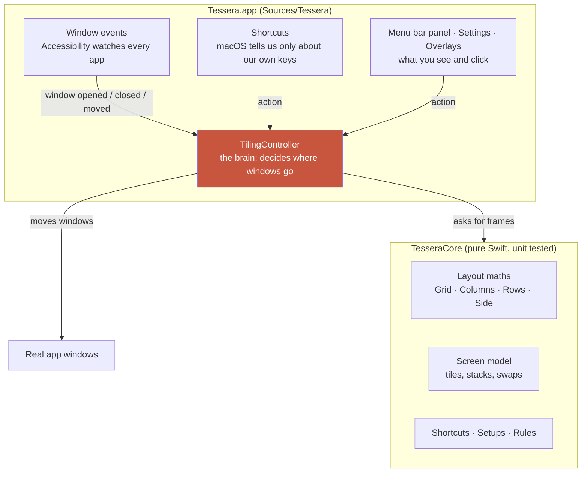
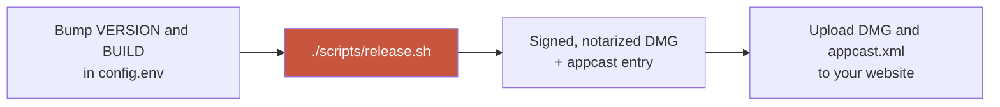

# Tessera

Tessera tiles your Mac's windows by itself. Open a window and it takes a tile. Close one and the rest fill the gap.

It matches Shoji's feature set: four layouts, stacks, swaps, Focus mode, No peek mode, Clean Space, Tab View, quick actions, Setups, custom shortcuts, five languages, a trial with license keys, and signed updates.

## Run it

You need macOS 15 or later and Xcode 16 or later.

```bash
cd ~/Developer/Tessera
./scripts/build-app.sh          # makes build/debug/Tessera.app
open build/debug/Tessera.app
```

On first launch, the welcome tour asks for **Accessibility access**. That is the macOS permission that lets an app move other apps' windows. Turn Tessera on in System Settings › Privacy & Security › Accessibility.

> **Tip:** Sign builds with a real certificate so macOS remembers that permission. With ad-hoc signing (no certificate), you must allow it again after every build. The build script picks your "Apple Development" certificate if Xcode has one.

## How it fits together



The brain never draws anything. It keeps a model of each screen, asks the core for frames, and moves windows to match. Overlays (borders, the hover bar, No peek) redraw after each change.

## Change things

| I want to… | Edit |
| --- | --- |
| Rename the app, bundle ID or version | `scripts/config.env` |
| Turn on licensing (Dodo Payments) | `CHECKOUT_URL` and `LICENSE_API` in `scripts/config.env` |
| Turn on updates (Sparkle) | `SPARKLE_FEED_URL` and `SPARKLE_PUBLIC_KEY` in `scripts/config.env` |
| Change a layout's shape | `Sources/TesseraCore/Layout/LayoutEngine.swift` |
| Change a default shortcut | `Sources/TesseraCore/Shortcuts/ShortcutAction.swift` |
| Change a default setting | `Sources/Tessera/App/Preferences.swift` |
| Add or fix a translation | `Resources/Localizable.xcstrings` (Xcode can edit it) |
| Change the icons | `AppIconStyle` in `Sources/Tessera/Services/AppServices.swift` |

Every visible string goes through `L("…")`. After adding strings, run:

```bash
python3 scripts/strings.py extract Resources/Localizable.xcstrings   # adds new keys
python3 scripts/strings.py check   Resources/Localizable.xcstrings   # lists missing translations
```

## Test

```bash
swift test
```

The tests cover the core: layouts, the solver (the part that fits windows with minimum sizes), stacks, swaps, navigation, shortcuts, setups and the trial clock. App code that talks to macOS is checked by running it.

## Ship a release



Notarizing means Apple scans the app so other Macs open it without a warning. You need a "Developer ID Application" certificate and a saved notary profile (`xcrun notarytool store-credentials`).

## Upgrade the tools

- **Swift or Xcode:** nothing to change. If a new Swift version warns about something, fix the warning.
- **Sparkle:** `swift package update`. The version range lives in `Package.swift`.
- **macOS minimum:** `MIN_MACOS` in `config.env`, and `.macOS(.v15)` in `Package.swift`.

## What lives where

```
Package.swift                 one file defines the whole build
Sources/TesseraCore/          pure logic, no AppKit
Sources/Tessera/
  App/                        start-up, settings store, live status
  AX/  Windows/               Accessibility wrapper, window and screen tracking
  Tiling/                     the brain, window mover, drag and hover handling
  Overlays/                   borders, hover bar, No peek, Clean Space, Tab View, notices
  Hotkeys/                    shortcuts and conflict checks
  Setups/  MenuBar/  SettingsUI/  Onboarding/  Services/
Resources/                    icon and translations
scripts/                      build, release, dev loop, strings
Tests/TesseraCoreTests/       unit tests (Swift Testing)
```

## Privacy

Tessera uses Accessibility only to move and resize windows. It never captures the screen, reads documents or saves window titles. Shortcuts are registered with macOS, so it never sees your typing. It connects to the internet only for license checks and updates, and both are off until you configure them.

## Open questions

- Shoji's exact animations and hover delays aren't public. Tessera uses short, calm values you can tune in `HoverBar.swift` and `PointerControllers.swift`.
- Spaces support uses private macOS calls, loaded safely at runtime. If a future macOS removes them, Tessera treats all Spaces as one instead of crashing.
