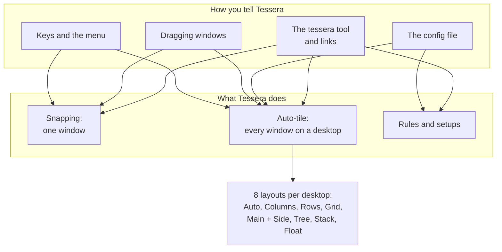

# Tessera docs

Start with [Getting started](getting-started.md), then read the guide for the way you like to work. Look things up in the reference.

## Find what you need

| I want to… | Read |
| --- | --- |
| Install Tessera and try it | [Getting started](getting-started.md) |
| Put one window in a half, third or corner | [Snapping](snapping.md) |
| Have every window arranged for me | [Auto-tile](auto-tile.md) |
| Split windows by hand, like AeroSpace or i3 | [The Tree layout](tree.md) |
| Work across desktops and several screens | [Desktops and screens](desktops-and-screens.md) |
| Float an app, or reopen a whole arrangement | [Rules and setups](rules-and-setups.md) |
| Set my own keys, modes and gaps in a file | [Config file](config.md) |
| Drive Tessera from scripts or an AI agent | [Command line tool](cli.md) |
| Use Shortcuts, Raycast, or copy settings to another Mac | [Links and settings files](links.md) |
| Switch from Rectangle, Shoji, AeroSpace or Spacetile | [Coming from another app](coming-from.md) |
| Fix something | [Troubleshooting](troubleshooting.md) |

## How the pieces fit

## Reference

| Page | Holds |
| --- | --- |
| [Every shortcut](shortcuts.md) | Default keys, mouse moves and key presets |
| [Command reference](commands.md) | Every command, with options and an example, and every snap name |
| [Config file](config.md#every-setting) | Every setting, its type and default |
| [Command line tool](cli.md#asking-questions) | Questions, JSON fields, exit codes, events, the socket |
| [What's new](../CHANGELOG.md) | Every version |

To work on Tessera itself, see [Developing Tessera](development.md) and [Contributing](../CONTRIBUTING.md).
