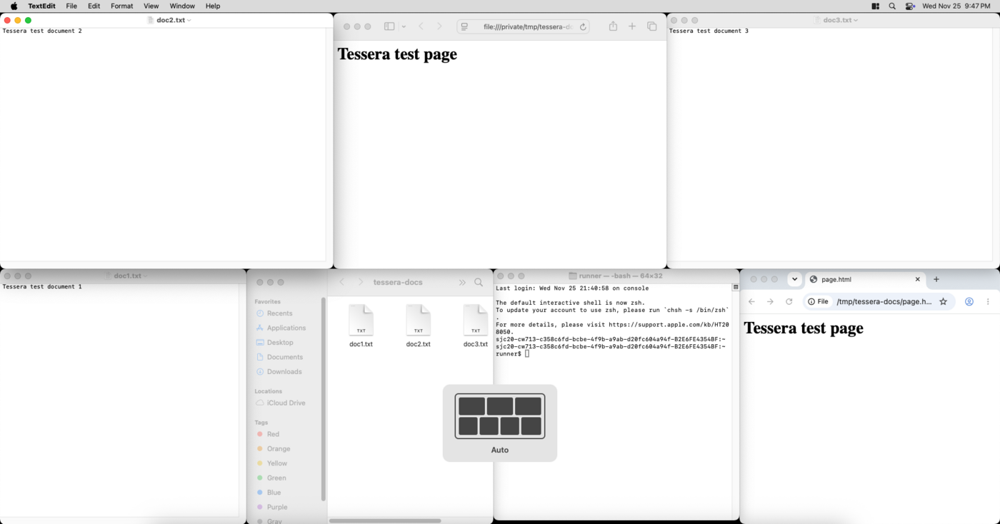
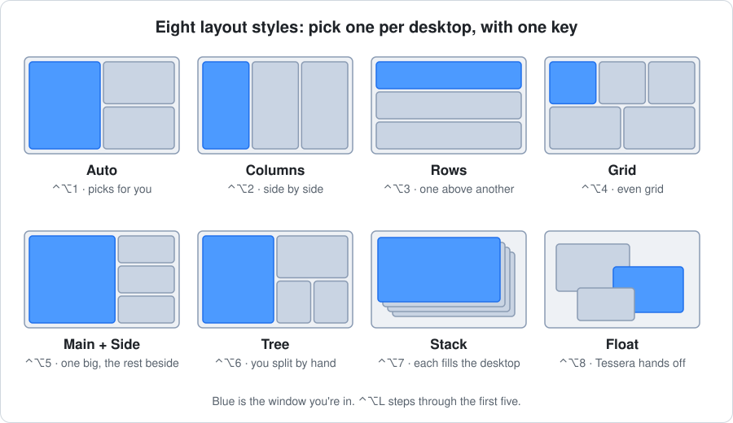
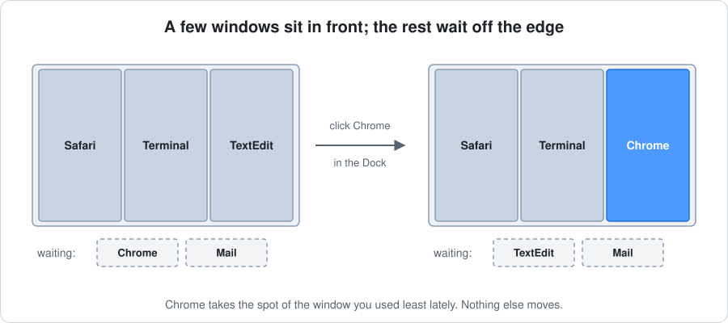
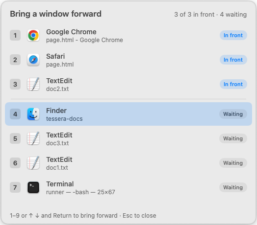
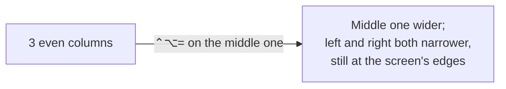
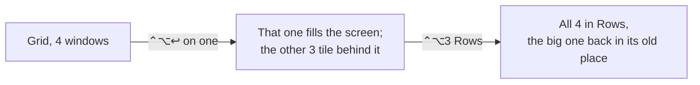

# Auto-tile

Auto-tile arranges every normal window on a screen so none overlap. Press **⌃⌥A** to turn it on or off. Each desktop on each screen keeps its own layout.

## The layouts

| Key | Layout | What it does |
| --- | --- | --- |
| ⌃⌥1 | **Auto** (the default) | Picks the best arrangement. 2 windows sit side by side, 3 get a main window and two stacked, 4 make a 2×2 grid. Portrait screens stack top to bottom. One window on an ultrawide screen is centred, not stretched. |
| ⌃⌥2 | Columns | Side by side |
| ⌃⌥3 | Rows | One above another |
| ⌃⌥4 | Grid | An even grid; the last row widens to fill the gap |
| ⌃⌥5 | Main + Side | One big main window; the rest stack beside it |
| ⌃⌥6 | **Tree** | You split windows by hand, like AeroSpace and i3. See [The Tree layout](tree.md). |
| ⌃⌥7 | Stack | Every window fills the desktop, one on top of another. `tessera stack next` steps through them. |
| ⌃⌥8 | Float | Tessera leaves every window where you put it |

**⌃⌥L** and **⌃⌥⇧L** step forward and back through the first five. Each switch shows a picture of the new layout in the middle of the screen. The menu shows the same pictures, drawn for the windows you have open.

**How Auto chooses.** It tries every grid, plus columns, rows and main + side. It scores each by how close every window is to a comfortable shape, a little wider than tall. The worst window counts extra, so nothing gets squashed into a strip.

**Apps that won't shrink.** Some apps stop at a minimum size (Chrome and Safari at about 500 points wide). Tessera notices, gives that window more room, and lets its neighbours share the rest. If a layout you picked can't fit everything, say seven windows in Columns, they overlap a little and the picture says so. Auto always looks for a layout where everything fits.

## Windows in front

Auto, Columns, Rows, Grid and Main + Side lay out only a few windows. The rest wait just off the edge of the screen, so a busy desktop stays calm, even on a laptop. (Tree, Stack and Float show every window.)

**How many:** by default, as many as fit at a comfortable size (at least 500 × 400 points each), worked out for each screen:

| Screen | Windows in front |
| --- | --- |
| 49-inch super ultrawide, 34-inch ultrawide | 6 |
| 27-inch | 4 |
| 16- or 14-inch MacBook Pro, 1920×1080, 20-inch 4:3 | 3 |
| 13-inch MacBook Air, 19-inch 5:4 | 2 |

Change it from the menu (**Windows in Front**) or Settings: 2 to 6, or No Limit.

**Use a waiting window and it comes forward.** Click it in the Dock, ⌘Tab to its app, or use ⌘\` or Mission Control. It takes the spot of the front window you used least lately. The other front windows don't move.

- **⌃⌥Space** opens the window picker: every window on this desktop, with a number. Press the number, or ↑ ↓ and Return.
- **The menu** also lists the windows in front and the ones waiting. Click one to bring it forward.
- **⌃⌥P** keeps a window in front, so it never steps back. You can keep all but one front spot.
- **New windows** come to the front, since you just opened them.
- **A closed or minimised front window** leaves its spot to the window you're in next, if it was waiting, or else to the waiting window you used most lately.
- **Turning auto-tile off, or quitting Tessera,** puts every waiting window back on screen. If Tessera ever crashes, the next launch brings any window left off screen back to the middle.

⌃⌥Space is also macOS's key for switching keyboard language. If you use that, give the picker another key in Settings.

 

## Working with tiles

| To | Do this |
| --- | --- |
| Move a window through the layout | **⌃⌥ + arrow**. It trades places with the window that way, and the layout keeps its shape. Past the screen's edge it goes to the next screen. |
| Swap two windows | Drag one onto the other. Or **⌃⌥M** to swap with the main window. |
| Move a window to another screen | Drag it there, or ⌃⌥⌘→ |
| Make a tile bigger or smaller | **⌃⌥=** and **⌃⌥−**. Its neighbours shrink to make room. Or drag the edge between two tiles: only the tile on the other side gives way. |
| Even the sizes out again | **⌃⌥⌫** (Restore) for one tile. Picking a layout evens them all. |
| Let one window float | **⌃⌥W**. Tessera leaves it where you put it, even when you change layout. Press again to tile it. |
| Keep a window out for good | Give its app the **Always Float** [rule](rules-and-setups.md), or ignore the app from the menu |
| Put everything back in the layout | **Retile** in the menu, or pick the layout again |

## Snapping a tiled window

**Snap or maximise a window by hand and it keeps that spot.** That covers ⌃⌥←, ⌃⌥↩, and macOS's own **Window › Fill**. The other windows tile in the rest of the screen. **⌃⌥⌫** (Restore) puts it back.

**The latest command wins.** Picking a layout (⌃⌥1–8, ⌃⌥L, the menu) or **Retile** puts every window on that desktop back into the layout. A window you snapped or maximised joins again, in its old place. A window in macOS full screen leaves full screen and joins too. Only floating windows (⌃⌥W) stay out.

## Gaps

**Settings › General** has two sliders: the gap between windows (0–30 points) and the gap at the screen's edges (0–60 points). The [config file](config.md#gaps) can set a different gap for each screen, for example less on the laptop.

## Shortcuts

| Key | Action |
| --- | --- |
| ⌃⌥A | Auto-tile on or off |
| ⌃⌥1 … ⌃⌥8 | Auto, Columns, Rows, Grid, Main + Side, Tree, Stack, Float |
| ⌃⌥L, ⌃⌥⇧L | Next and previous layout (the first five) |
| ⌃⌥ + arrow | Move the window one spot through the layout |
| ⌃⌥M | Swap this window with the main one |
| ⌃⌥W | Float this window, or tile it again |
| ⌃⌥P | Keep this window in front |
| ⌃⌥Space | Window picker |

---

[Docs home](README.md) · Back: [Snapping](snapping.md) · Next: [The Tree layout](tree.md)
