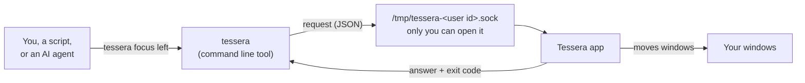

# Command line tool

`tessera` runs any Tessera command and answers questions about your windows, as text or JSON. It's made for scripts, launchers and AI agents.

```bash
tessera list-windows --json        # every window, as JSON
tessera focus left                 # do something
tessera layout tree && tessera join right
```

## Install

- **Homebrew** installs it with the app (see [Getting started](getting-started.md)).
- **Otherwise:** menu › **Config and Command Line › Install Command Line Tool…**. It links `tessera` into `/opt/homebrew/bin`, `/usr/local/bin` or `~/.local/bin`, whichever you can write to.

Check it works: `tessera version`.

## How it works



The tool does nothing on its own: it hands each command to the running Tessera app and prints the answer. If Tessera isn't running, it says so and exits with 2. `tessera help` works either way.

## Running commands

Any [command](commands.md) works, with its words as separate arguments:

```bash
tessera place left 2/3
tessera send-to-desktop 2
tessera --window-id 1234 layout floating     # act on a window other than the one you're in
tessera 'layout columns; focus left'         # several, in one quoted line
tessera 'zoom || layout tree'                # || runs only if the first failed; && only if it worked
tessera help resize                          # what a command does, with an example
```

AeroSpace's and Spacetile's command names work too: `workspace 2`, `focus west`, `move-node-to-workspace 3`.

### Exit codes

| Code | Means | Example |
| --- | --- | --- |
| 0 | It worked | `tessera focus left` |
| 1 | It ran but failed: no such window, nothing that way, nothing to do | `tessera --window-id 999999 close` |
| 2 | Tessera isn't running | — |
| 3 | Not understood: unknown command or bad argument. The message says why. | `tessera focus sideways` |

A typo is caught before Tessera is even asked, so exit code 3 never moves a window.

## Asking questions

| Command | Answers |
| --- | --- |
| `list-windows` | Windows on the desktops your screens show now |
| `list-windows --all` | Every window, on every desktop |
| `list-windows --focused` / `--desktop 2` / `--display 2` / `--app-bundle-id ID` / `--pid N` | Only those windows |
| `list-displays` | The screens |
| `list-desktops` | Each screen's desktops, and the layout of the one showing |
| `list-apps` | Running apps |
| `list-modes --current` | The binding mode now |
| `tree` | The [Tree layout](tree.md) of each screen, as text: `H[1234 V[5678 9012]]` |
| `config` | The config file: its path, problems, modes and rules |
| `version` | Tessera's version |

Each list prints a table by default. Add one of these to change it:

| Flag | Prints |
| --- | --- |
| `--json` | JSON, for programs |
| `--count` | Just how many |
| `--format '%{window-id} %{app-name}'` | One line each, with `%{field}` filled in (`%%` is a percent sign) |

### What `list-windows --json` gives

```json
[
  {
    "app-bundle-id" : "com.apple.TextEdit",
    "app-name" : "TextEdit",
    "app-pid" : 1042,
    "desktop" : 1,
    "display-name" : "Built-in Retina Display",
    "display-number" : 1,
    "focused" : true,
    "frame" : [0, 25, 640, 981],
    "state" : "tiled",
    "window-id" : 1234,
    "window-title" : "notes.txt"
  }
]
```

| Field | Meaning |
| --- | --- |
| `window-id` | The id every command takes with `--window-id` |
| `frame` | x, y, width, height in points; y counts down from the top of the main screen |
| `display-number` | Screens counted from the left, from 1 |
| `desktop` | The desktop's number on its screen, from 1 |
| `state` | `tiled`, `floating`, `waiting` (off screen, not in front), `zoomed`, `minimized` or `fullscreen` |

`list-displays --json` gives each screen's `display-number`, `display-name`, `display-id`, `main`, `focused`, `frame`, `visible-frame` (without the menu bar and Dock), `desktop`, `layout` and `front-limit`. `list-desktops --json` gives `display-number`, `display-name`, `desktop`, `showing`, `focused`, `layout` and `window-count`.

## Following events

`tessera subscribe` prints one JSON line per event, as it happens, until you stop it. Name the events you want, or leave them out for all.

```bash
tessera subscribe focus-changed desktop-changed
{"app-bundle-id":"com.apple.Safari","app-name":"Safari","event":"focus-changed","window-id":5678}
{"desktop":2,"event":"desktop-changed","previous":1}
```

| Event | Fields |
| --- | --- |
| `focus-changed` | `window-id`, `app-bundle-id`, `app-name` |
| `display-focus-changed` | `display` (the screen's id) |
| `desktop-changed` | `desktop`, `previous` |
| `mode-changed` | `mode` |
| `window-detected` | `window-id`, `app-bundle-id`, `app-name` |
| `window-closed` | `window-id` |

For a command that should run on every event, use a [callback](config.md#callbacks-and-shell-commands) in the config file instead.

## For AI agents

A few habits make an agent reliable:

1. **Read before you act.** `tessera list-windows --json` and `tessera list-displays --json` give ids, apps, titles and frames.
2. **Use window ids, not "the focused window".** Focus can move while you work. Pass `--window-id`.
3. **Check the exit code.** 0 done, 1 failed (read stderr), 2 start Tessera, 3 fix the command.
4. **Check the result.** After a change, ask again: `list-windows --json`, or `tree` for the Tree layout.
5. **Ask for help on one command:** `tessera help COMMAND` prints its options and an example. `tessera help` lists them all.

```bash
# Put Safari and Notes side by side, Safari on the left.
safari=$(tessera list-windows --app-bundle-id com.apple.Safari --format '%{window-id}' | head -1)
notes=$(tessera list-windows --app-bundle-id com.apple.Notes --format '%{window-id}' | head -1)
tessera --window-id "$safari" place left && tessera --window-id "$notes" place right

# Wait for the next window to open, then float it.
read -r event < <(tessera subscribe window-detected)
id=$(echo "$event" | sed -E 's/.*"window-id":([0-9]+).*/\1/')
tessera --window-id "$id" layout floating
```

## Writing your own client

The tool is a thin client; any program can speak to Tessera the same way.

- **Socket:** `/tmp/tessera-<your user id>.sock` (a Unix socket only you can open).
- **Framing:** each message is 4 bytes of length (little-endian), then that many bytes of JSON. Up to 8 MB.
- **Request:** `{"version": 1, "args": ["focus", "left"], "windowID": 1234}`. `args` is the command's words, or one string holding a whole command line. `windowID` is optional.
- **Response:** `{"exitCode": 0, "stdout": "…", "stderr": "", "serverVersion": "3.0.0", "streaming": false}`. With `subscribe`, `streaming` is true and event lines follow until you close the connection.

---

[Docs home](README.md) · Back: [Config file](config.md) · Next: [Links and settings files](links.md)
