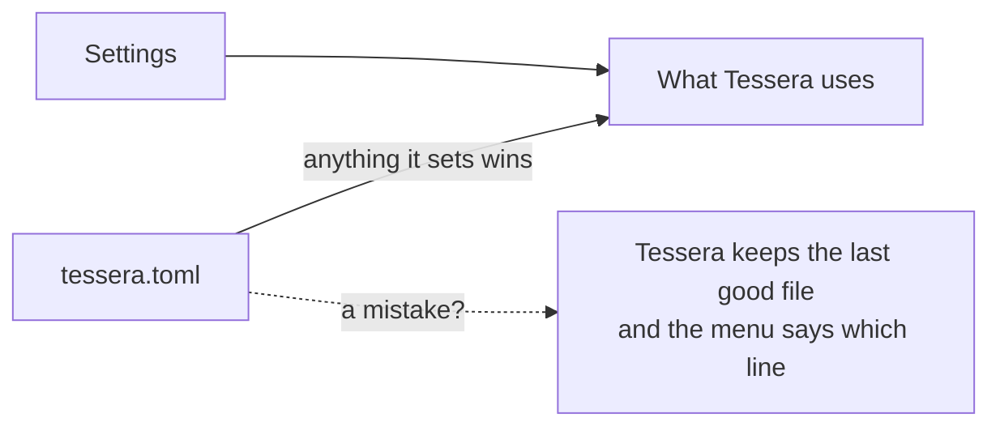
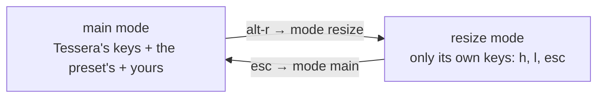

# Config file

The config file is optional. Without it, Tessera runs from Settings alone. With it, you get what Settings can't do: your own keys, binding modes, window rules, callbacks, and gaps for each screen. It uses the same format as AeroSpace's, so an `aerospace.toml` mostly works as it is.

## Where it lives

`~/.config/tessera/tessera.toml` (or `~/.tessera.toml`, or under `$XDG_CONFIG_HOME/tessera/`). `tessera config --config-path` prints the one Tessera reads.

| To | Do this |
| --- | --- |
| Make one | Menu › **Config and Command Line › Make a Config File**. It writes a starter file with the main options explained, and opens it. |
| Start from AeroSpace | Menu › **Config and Command Line › Import AeroSpace Config…** (see [below](#coming-from-aerospace)) |
| Reload it | Save the file: the starter file has `auto-reload-config = true`. Or run `tessera reload-config`, or menu › **Reload Config File**. |
| See what Tessera read | `tessera config` lists the file, its problems and its modes |



**A mistake never stops Tessera.** It keeps using the last good file, and a ⚠︎ line in the menu says what's wrong and on which line. Unknown settings are listed too, then skipped.

## A full example

```toml
# Settings that aren't in a [table] go first (a TOML rule).
auto-reload-config = true
auto-tile = true
layout = 'tree'                        # the layout for new desktops
preset = 'aerospace'                   # extra keys: tessera, spectacle, aerospace, spacetile, none
on-focus-changed = ['move-mouse window-lazy-center']
after-startup-command = ['layout tree']

[layouts]                              # per screen, by name or position
'built-in' = 'auto'                    # the laptop screen stays on Auto

[gaps]
inner.horizontal = 10                  # between windows
inner.vertical = 10
outer.left = 12                        # at the screen's edges
outer.right = 12
outer.bottom = 12
outer.top = [{ monitor.'built-in' = 4 }, 12]

[mode.main.binding]
alt-h = 'focus left'
alt-shift-h = 'move left'
alt-f = 'zoom'
alt-r = 'mode resize'                  # switch to the resize mode below

[mode.resize.binding]                  # plain keys work inside a mode
h = 'resize width -50'
l = 'resize width +50'
esc = 'mode main'

[[on-window-detected]]
if.app-id = 'com.apple.calculator'
run = 'layout floating'

[appearance]
border = true
border-color = '#4c9aff'
```

## Every setting

Every setting is optional. Left out, it keeps its value from Settings (the default shown here).

### General

| Setting | Type | Default | What it does |
| --- | --- | --- | --- |
| `auto-tile` | true / false | false | Turn auto-tile on or off |
| `start-at-login` | true / false | false | Open Tessera when you log in |
| `auto-reload-config` | true / false | false | Read the file again each time you save it |
| `layout` | layout name | `auto` | The layout for every screen's new desktops: `auto`, `columns`, `rows`, `grid`, `main-and-side`, `tree`, `stack`, `float` |
| `layouts` | table | — | A layout per screen: `'built-in' = 'auto'`. Screen names are [patterns](#screen-patterns). |
| `front-limit` | `'auto'`, `'none'`, 1–12 | `'auto'` | How many windows sit in front ([windows in front](auto-tile.md#windows-in-front)) |
| `main-ratio` | 0.2–0.8 | 0.5 | The main window's share of the screen in Main + Side |
| `ignored-apps` | list of app ids | Calculator, System Settings | Apps Tessera never snaps or tiles |
| `automatically-unhide-macos-hidden-apps` | true / false | false | Bring hidden apps straight back (undo ⌘H) |

### Snapping and the mouse

| Setting | Type | Default | What it does |
| --- | --- | --- | --- |
| `drag-to-snap` | true / false | true | Snap by dragging to an edge or corner |
| `restore-size-on-drag` | true / false | true | A window dragged out of a snap gets its old size back |
| `cycle-sizes` | true / false | true | Pressing a half again cycles ½, ⅔, ⅓ |
| `mouse.move-modifier` | `fn`, `ctrl-cmd`, `cmd-alt`, `ctrl-alt`, `none` | `fn` | Hold this to drag a window from anywhere in it |
| `focus-follows-mouse` | true / false | false | Focus the window under the pointer (also `mouse.focus-follows-mouse`) |

### The Tree layout

| Setting | Type | Default | What it does |
| --- | --- | --- | --- |
| `accordion-padding` | points | 30 | How much of each neighbour shows in an accordion |
| `default-root-container-layout` | `tiles`, `accordion` | `tiles` | The style of a new desktop's first split |
| `default-root-container-orientation` | `horizontal`, `vertical`, `auto` | `auto` | The way a new desktop's first split runs; `auto` goes by the screen's shape |

### Look

These can sit at the top level or in an `[appearance]` table.

| Setting | Type | Default | What it does |
| --- | --- | --- | --- |
| `dim` | true / false | false | Dim every window except the one you're in |
| `dim-amount` | 0–0.9 | 0.25 | How dark |
| `border` | true / false | false | A border round the window you're in |
| `border-width` | 1–20 points | 4 | Its width |
| `border-color` | `'#rrggbb'` | `'#4c9aff'` | Its colour |
| `show-desktop-number` | true / false | false | Show the desktop's number in the menu bar |

### Gaps

```toml
[gaps]
inner.horizontal = 8          # between windows, side by side
inner.vertical = 8            # between windows, one above another
outer.left = 8                # at each edge of the screen
outer.right = 8
outer.top = 8
outer.bottom = 8
```

`inner = 8` and `outer = 8` set all of them at once. Any value can differ per screen: a list of `{ monitor.<pattern> = number }`, then the number for every other screen.

```toml
outer.top = [{ monitor.main = 40 }, { monitor.'dell' = 20 }, 8]
```

Tessera uses one inner gap: if `inner.horizontal` and `inner.vertical` differ, it takes the larger.

### Screen patterns

Used by `layouts` and per-screen gaps.

| Pattern | Matches |
| --- | --- |
| `main` | The main screen (with the menu bar) |
| `secondary` | The other screen, when there are exactly two |
| `1`, `2`, … | Screens counted from the left |
| Anything else | Part of the screen's name, as a regular expression, any case: `'built-in'`, `'dell'`, `'LG.*5K'` |

`tessera list-displays` shows each screen's name and number.

## Key bindings and modes

Keys live in **binding modes**. `main` is the usual one. A mode you add (like `resize` above) holds only its own keys, so plain keys such as `h` work there. Switch with the `mode` command; `tessera list-modes --current` shows which is on, and the menu shows it too.



**A key** is modifiers and a key name joined by `-`: `alt-shift-h`, `ctrl-alt-left`, `cmd-alt-f1`.

| Part | Names |
| --- | --- |
| Modifiers | `cmd`, `alt` (or `opt`), `ctrl`, `shift` |
| Letters and digits | `a` … `z`, `0` … `9` |
| Arrows and editing | `left`, `right`, `up`, `down`, `enter`, `esc`, `backspace`, `forwarddelete`, `tab`, `space`, `home`, `end`, `pageup`, `pagedown` |
| Symbols | `minus`, `equal`, `comma`, `period`, `slash`, `backslash`, `semicolon`, `quote`, `backtick`, `leftsquarebracket`, `rightsquarebracket`, `sectionsign` |
| Function keys and keypad | `f1` … `f20`, `keypad0` … `keypad9`, `keypadenter`, `keypadplus`, and the rest of the keypad |

**A binding** runs one [command](commands.md), a list of them, or a chain: `alt-f = 'layout tree; zoom'`.

**Which keys win.** In `main`, your bindings come first, then the preset's, then Tessera's own shortcuts from Settings. Your key replaces Tessera's on the same key. If another app already owns a key, the menu says so with a ⚠︎ line.

**Presets** add a set of keys to `main`:

| `preset` | Adds |
| --- | --- |
| `tessera` (default) | Nothing extra: Tessera's own Rectangle-style keys |
| `spectacle` | Spectacle's keys: ⌘⌥ arrows for halves, ⌘⌥F maximise, ⌘⌃ arrows for corners… |
| `aerospace` | AeroSpace's defaults: alt-h/j/k/l focus, alt-shift-h/j/k/l move, alt-1…9 desktops, alt-shift-1…9 send, alt-slash and alt-comma for split styles, and a `service` mode on alt-shift-semicolon |
| `spacetile` | Spacetile's: alt-arrows focus, alt-s stack, alt-d tree, alt-n/p step the stack, alt-1…9 desktops |
| `none` | Nothing: not even Tessera's own shortcuts, only your file's keys (same as `builtin-shortcuts = false`) |

**Other keyboards.** `key-mapping.preset = 'dvorak'` (or `'colemak'`) reads letter keys as they're labelled on that layout. `[key-mapping.key-notation-to-key-code]` adds your own names.

## Window rules

`[[on-window-detected]]` runs commands when a window opens. See [Window rules](rules-and-setups.md#window-rules) for the conditions and examples.

## Callbacks and shell commands

| Setting | Runs when |
| --- | --- |
| `after-startup-command` | Tessera starts (a list of commands) |
| `on-focus-changed` | The focus moves to another window |
| `on-focused-monitor-changed` (or `on-display-focus-changed`) | The focus moves to another screen |
| `on-mode-changed` | The binding mode changes |
| `exec-on-workspace-change` (or `exec-on-desktop-change`) | The desktop changes. A program and its arguments: `['/bin/bash', '-c', 'echo $TESSERA_FOCUSED_DESKTOP']` |

`exec-and-forget` runs a shell command from any binding or callback. Shell commands get Homebrew on their `PATH`, and these variables:

| Variable | Holds |
| --- | --- |
| `TESSERA_WINDOW_ID` (and `AEROSPACE_WINDOW_ID`) | The window the command is for |
| `TESSERA_FOCUSED_DESKTOP`, `TESSERA_PREV_DESKTOP` (and the `AEROSPACE_…_WORKSPACE` names) | The desktop now and before, for `exec-on-workspace-change` |

`[exec]` sets the environment: `inherit-env-vars = false` starts from nothing, and `[exec.env-vars]` adds variables (`PATH = '${PATH}:/my/bin'`).

## Coming from AeroSpace

**Import AeroSpace Config…** copies your `aerospace.toml` into `tessera.toml` and lists, at the top, the lines that won't work here. An older `tessera.toml` is kept as `tessera.toml.bak`.

| AeroSpace has | In Tessera |
| --- | --- |
| Its settings, rules, callbacks, modes and commands | Read as they are |
| Numbered workspaces (`workspace 2`) | Your macOS desktops, numbered on each screen |
| Named workspaces (`workspace A`), `persistent-workspaces`, `workspace-to-monitor-force-assignment` | Skipped, with a note: Tessera uses real macOS desktops |
| Turning normalization off | Not possible: Tessera always keeps the tree tidy |

[Coming from another app](coming-from.md) has the full list.

---

[Docs home](README.md) · Back: [Rules and setups](rules-and-setups.md) · Next: [Command line tool](cli.md)
