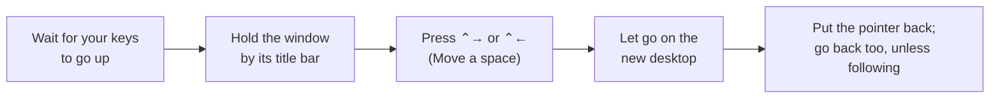
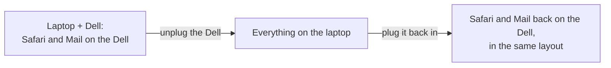

# Desktops and screens

Tessera works with your real macOS desktops (Spaces) and every screen you plug in. Each desktop on each screen has its own layout, and nothing jumps when you switch.

## Focus by direction

**⌃⇧⌘ + arrow** focuses the window to the left, right, above or below, on any screen. It prefers a window in line with yours, then the nearest. Waiting windows are skipped. From the command line: `tessera focus left`, or `tessera focus back` for the window you were in before.

## Desktops

Tessera's "workspaces" are your macOS desktops, numbered from 1 on each screen.

| To | Key | Command |
| --- | --- | --- |
| Go to desktop 3 | Your Mission Control key | `tessera desktop 3` |
| Go to the next, previous, or last desktop | — | `tessera desktop next`, `prev`, `last` |
| Send this window to desktop 2, and go with it | ⌃⌥⇧2 | `tessera send-to-desktop 2` |
| Send it, and stay where you are | — | `tessera move-node-to-workspace 2` |

`desktop last` goes back to the desktop you were on before, like AeroSpace's `workspace-back-and-forth`.

**For instant switching** to a numbered desktop, turn on **Switch to Desktop 1, 2, 3…** in **System Settings › Keyboard › Keyboard Shortcuts › Mission Control**. Without those, Tessera steps there one desktop at a time.

### How sending a window works

macOS has no way for one app to move another app's window to a desktop. So Tessera does what you would do by hand:



For this, **Move left a space** and **Move right a space** must be on in **System Settings › Keyboard › Keyboard Shortcuts › Mission Control**. They are on unless you turned them off.

### What stays still

- **Only the desktop on screen counts.** Swiping to another desktop never moves a window.
- **Each desktop keeps its own layout.** A desktop Tessera hasn't seen yet starts with the layout you picked last (or the config file's `layout`).
- **A window set to show on every desktop** is left alone.
- **Show the desktop's number in the menu bar:** **Settings › Focus and Look**.

## Several screens

- **Each screen has its own layout and its own number of windows in front.** Waiting windows hang off a free edge of their own screen, never over another screen, however the screens are arranged.
- **⌃⌥⌘→ and ⌃⌥⌘←** move a window to the next or previous screen. `tessera send-to-display next` does too, and `tessera focus-display next` moves the focus.
- **Unplug a screen, or close the laptop lid,** and Tessera remembers what that screen held: its windows in order, which were in front, and its layout. Plug it back in and they go back to it as they were, unless you moved one yourself in the meantime.
- **New windows of one app can always open on one screen.** Give the app a **New Windows Open On** [rule](rules-and-setups.md#app-rules).
- **A setup can open by itself** when you plug in the screens it uses. See [Setups](rules-and-setups.md#setups).



## Gaps per screen

A gap that suits a big screen can be too much on a laptop. The [config file](config.md#gaps) sets gaps per screen, by name or by position:

```toml
[gaps]
outer.top = [{ monitor.'built-in' = 4 }, 16]   # 4 on the laptop screen, 16 elsewhere
```

---

[Docs home](README.md) · Back: [The Tree layout](tree.md) · Next: [Rules and setups](rules-and-setups.md)
