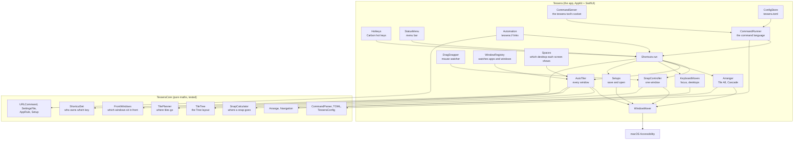
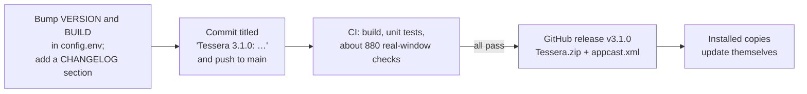

# Developing Tessera

How Tessera is built, tested and released. To use Tessera, start at the [docs home](README.md) instead.

```bash
git clone https://github.com/vik101/Tessera && cd Tessera
swift test                       # unit tests (TesseraCore), in seconds
./scripts/build-app.sh           # debug app → build/debug/Tessera.app
open build/debug/Tessera.app
```

You need Xcode 16 or later (Swift 6) on macOS 15 or later.

## How the code fits together



All the maths lives in **TesseraCore**, which has no AppKit. That is where almost every behaviour change happens, and its tests run in seconds. The app layer only reads windows, moves them, and draws the menu and Settings.

| Folder | What's inside |
| --- | --- |
| `Sources/TesseraCore/Snapping` | `SnapAction` (every action, its title, default shortcut and screen region) and `SnapCalculator` |
| `Sources/TesseraCore/Tiling` | `TilePlanner` (layout styles, Auto's scoring, space left by snapped windows) and `FrontWindows` (the front-window limit: who sits in front, who waits, who steps back) |
| `Sources/TesseraCore/Shortcuts` | Key combos, commands, and the user's shortcut set |
| `Sources/TesseraCore/Automation` | Links (`URLCommand`), settings files, app rules, setups |
| `Sources/TesseraCore/Tree` | `TileTree`: the Tree layout's splits, and every change to them (join, move, resize…) |
| `Sources/TesseraCore/Commands` | The command language (`TextCommand.swift`), its help, and the command line tool's wire format |
| `Sources/TesseraCore/Config` | A TOML reader, `TesseraConfig` (the config file, AeroSpace's keys too) and key names like `alt-shift-h` |
| `Sources/Tessera/Commands` | Running commands and queries, the socket server, events and callbacks |
| `Sources/TesseraCLI` | The `tessera` command line tool (it only talks to the app) |
| `Sources/Tessera/Snapping` | Keyboard and mouse snapping |
| `Sources/Tessera/Tiling` | `AutoTiler`: decides which windows to tile and when |
| `Sources/Tessera/Windows` | Window tracking, screens, desktops (`Spaces.swift`), moving windows |
| `Sources/Tessera/UI` | Menu, Settings, the window picker (`WindowPicker.swift`), permission window, overlays |
| `Tests/TesseraCoreTests` | Unit tests for every snap and layout |
| `scripts/` | Build, release, and the real-Mac test (`smoke-test.sh`, `ci/check.py`, `ci/screens.py`, `ci/v3.py`) |

## How auto-tile stays still

A tiler that moves windows when nothing changed feels broken. Three rules in `AutoTiler` and `WindowMover` stop that:

1. **Only the desktop on screen counts.** During a swipe, windows from two desktops are on screen at once. `Spaces` asks macOS which desktop each window lives on, and the other desktop's windows are left out. While a swipe is still under way, Tessera waits.
2. **A change must be seen twice.** The half-second check acts only when it sees the same new set of windows two times in a row. Brief in-between states never cause a move.
3. **Never ask twice for the same thing.** If a window can't get as small as its tile, `WindowMover` remembers where it ended up. Asking again would only make it jump and come back, so it doesn't.

macOS has no public way to read desktops. `Spaces.swift` uses the window server's own functions, like yabai and Amethyst do. If a future macOS removes them, Tessera still works, and rule 2 keeps it calm.

## How tile sizes work

Each tile has a width share and a height share (`TileSizes.swift`); 1 is an even share. `TilePlanner` shares out each line (a row or a column of tiles) by those shares, and each line's thickness by the biggest share in it. App minimum sizes still win. So:

- ⌃⌥= multiplies a tile's shares by 1.25, ⌃⌥− divides them, between a quarter and four times even. Six presses back undo six presses exactly.
- Dragging an edge (`TileSizes.afterDrag`) finds every tile that ends at that edge and every tile that starts just past it, moves the edge for all of them, and turns the new sizes into shares.
- In Main + Side, the edge next to the main window sets the main window's share of the screen, as before.

## How the front-window limit works

All the rules are small functions in `FrontWindows.swift`, with tests in `FrontWindowsTests.swift`. Each one only reorders the list of windows on a screen (the tile order). The first few in the list sit in front; the rest wait. Because the list is the same one swapping and dragging use, those keep working unchanged.

| When | Rule |
| --- | --- |
| A waiting window is used | `bringForward`: it swaps places with the front window used least lately (never a kept one) |
| Windows ask for the front | `arrange`: kept windows first, then new or used ones, oldest wish first; the rest line up most lately used first |
| A front window leaves | `fillSpots`: the window you're in (if waiting), or else the waiting one used most lately, takes its exact spot |
| Any time | `waitingFrame`: waiting windows hang off a free edge (bottom corners first), one point on screen, never over another screen |
| Screens change | `refill`: windows that moved screens; the most lately used get the front spots there |

`AutoTiler` keeps a "last used" number for each window. It goes up whenever you focus a window.

## Build and test

```bash
swift test                       # unit tests
./scripts/build-app.sh           # debug app   → build/debug/Tessera.app
./scripts/build-app.sh release   # Apple silicon + Intel → build/release/Tessera.app
./scripts/release.sh             # DMG, notarized if NOTARY_PROFILE is set
```

Version, bundle ID and signing live in `scripts/config.env`. `CHANGELOG.md` holds each version's release notes.

## Releasing



Only a commit whose title starts with `Tessera <VERSION>` publishes, and only when every check passes. Each version is released once.

**One-time setup** (on your Mac, with `gh auth login` done): `./scripts/setup-release-keys.sh`. It makes two keys and stores them as GitHub secrets:

| Key | What it does | Without it |
| --- | --- | --- |
| Tessera Signing certificate | Releases keep the Accessibility permission when they update | Ad-hoc signing: macOS asks for Accessibility again after every update |
| Sparkle update key | Releases carry a signed `appcast.xml`, so installed copies update themselves | No auto-update; people download new versions by hand |
| Apple Developer ID (optional, paid) | Releases are notarized, so macOS opens the first download without a warning | macOS warns on the first open; Homebrew removes the warning for you |

For a Developer ID, add the secrets listed at the top of `setup-release-keys.sh`. The release job notarizes when they exist.

`signing` in `tessera-build.yml` proves this pipeline on every push with throwaway keys. It checks that an update signed with the same certificate keeps Accessibility, an ad-hoc update loses it, and the appcast's signature matches the download. Results go to the `tessera-ci-signing` branch.

## Common changes

| To change… | Edit |
| --- | --- |
| A default shortcut | `defaultShortcut` in `SnapAction.swift` or `Commands.swift` (layouts too) |
| Where an action puts a window | `region(shape:cycle:)` in `SnapAction.swift` |
| How Auto picks a layout | `score` and `idealAspect` in `TilePlanner.swift` |
| Add a layout style | Add a case to `LayoutStyle`, and its shape in `TilePlanner.frames` |
| Apps ignored by default | `ignoredApps` default in `Settings.swift` |
| An action's link name | `rectangleName` in `SnapAction.swift`, `urlName` in `Arrange.swift`, `Navigation.swift`, `Commands.swift` |
| What a link can do | `URLCommand.swift` (parsing) and `Automation.swift` (running it) |
| What a settings file holds | `SettingsFile.swift`, then `file` and `apply` in `Settings.swift` |
| How Tile All, Cascade and stacks work | `Arrange.swift` (maths) and `Arranger.swift` (windows) |
| Focus by direction, desktop moves | `Navigation.swift` (maths) and `KeyboardMoves.swift` (windows) |
| App rules, setups | `AppRule.swift`, `Setup.swift` (core); `AutoTiler.swift`, `Setups.swift` (app) |
| Add a command | Parse it in `TextCommand.swift`, describe it in `CommandHelp.swift`, run it in `CommandRunner.swift` |
| Add a config setting | `TesseraConfig.swift` (reading it, and `template`), then `ConfigStore.apply` |
| How the Tree layout changes | `TileTree.swift`; `AutoTiler.treeLayout` turns it into window frames |

Add a test in `Tests/TesseraCoreTests` with each change. The `everyWindowGetsItsOwnSpace` test checks every style, 1 to 12 windows, on four screen shapes. `everyStyleKeepsItsShapeWithRealAppSizes` checks each style still has its shape when apps won't shrink.

## Testing on a real Mac

`.github/workflows/tessera-build.yml` runs on GitHub's Macs for every push, on macOS 15 and macOS 26 (Tahoe). It builds, runs the unit tests, then `scripts/smoke-test.sh` opens TextEdit, Finder, Safari, Chrome and Terminal on a 1920×1080 screen and presses the real shortcuts. `scripts/ci/check.py`, `screens.py` and `v3.py` make about 880 checks:

- Every snap: each window's exact position against what it should be, and drags to every edge.
- Every layout: picked with ⌃⌥1–5, two full rounds of ⌃⌥L, back again with ⌃⌥⇧L, and clicked in the menu (through Accessibility, as a person would). Each time it checks the layout really has that shape (Columns are side by side and full height, and so on), the windows are where planned, nothing overlaps when it fits, and the second round matches the first.
- With 7, 3 and 1 windows, and while windows open, close, hide and minimise.
- The latest command wins: maximise (Tessera's, and macOS Fill and full screen), then a layout. Every window must join it.
- Desktops: it adds a second desktop, gives it its own layout, then swipes back and forth. It watches every window ten times a second, and fails if any moves.
- Several screens (`scripts/ci/screens.py`): it adds a pretend 49-inch and a squarish Dell beside the main screen, spreads 12 windows across them, drags one, rearranges the screens, unplugs and replugs the Dell. After each step it checks every screen keeps its own limit, nothing overlaps, no waiting window shows on any screen, no window is lost, and nothing moves once settled.
- Tile sizes: three columns, ⌃⌥= three times on the middle one: it must grow, the left and right columns must shrink evenly, and they must still reach the screen's edges with no holes. Then ⌃⌥− back to even, ⌃⌥⌫, Rows, Main + Side, and dragging the edge between two columns with the mouse.
- Rectangle's other actions, through `tessera://` links: ninths, eighths, corner thirds, Centre Prominently, Specified, and an unknown name that must move nothing. Ignore and unignore an app by link. Export settings, change the file, import it.
- All windows at once: Tile All, Tile in Columns, Reverse All and Cascade All, each checked window by window. Two windows on one spot for Next and Previous Stacked Window.
- Focus by direction (⌃⇧⌘ + arrows) across three columns, and at the screen's edge.
- Send to desktop: ⌃⌥⇧2 sends a window to desktop 2 and it tiles there; ⌃⌥⇧1 brings it back.
- App rules from a settings file: Terminal always floats; Safari always in front never waits; on several screens, TextEdit's new windows open on the Dell.
- Setups: save by link, maximise the windows, open the setup: each window must be back in its place, and the window that was in front is in front.
- Windows in front: with a limit of 3, the other windows wait off screen. It then brings windows forward from their app, the menu and the ⌃⌥Space picker, and checks each one takes the right spot and nothing else moves. It also covers new and closed windows, minimising, ⌃⌥P, Auto, turning auto-tile off and No Limit.
- Tessera 3.0 (`scripts/ci/v3.py`), mostly through the `tessera` tool: its answers and exit codes, and 12 calls at once; every Tree command, checked by the tree's shape and each window's place; drop zones and fn-drag; Stack and Float, by command, by ⌃⌥6–8 and by link; minimise and float, each coming back to the same spot; native full screen, which must not leave a window pinned; an app that won't shrink in Tree; dim and border; events; a config file with gaps, keys (one replacing a built-in key), a binding mode that lets go of its keys, a rule and a callback; a broken config that must keep the last good one; an AeroSpace import; desktop commands, watching for jumps; a setup that opens when its screen is plugged in. Last, it quits Tessera and checks the tool says so (exit 2).

Results and screenshots go to the `tessera-ci` branch (`tessera-ci-latest` for Tahoe). A quick job (build and unit tests only) publishes to `tessera-ci-quick` within minutes.

`launch-test.yml` also opens the downloadable app with a second screen attached and checks it starts, its menu opens and its keys work.

The test talks to Tessera through a hidden switch that is off by default:
`defaults write com.vikram.Tessera TesseraTestHooks -bool YES`.

## Docs

The docs are Markdown in `docs/`, written for users first: plain words, short sentences, a picture where something has a shape.

| File | Made by |
| --- | --- |
| `docs/commands.md` | `python3 scripts/docs/commands.py`, from `CommandHelp.swift`, `SnapAction.swift` and `TextCommand.swift`. Don't edit it by hand. CI's quick job reports when it's out of date. |
| `docs/images/*.svg` | `python3 scripts/docs/images.py` (layouts, snap keys and areas, the Tree layout, windows in front) |
| `docs/images/*.png` | Screenshots from the real-Mac test, on the `tessera-ci` branch (`layout-7-windows-auto.png`, `menu.png`, `settings.png`, `picker.png`, `permission.png`, `v3-dim-border.png`), cropped |
| Everything else | By hand |

Pushes that change only docs skip the Mac jobs in CI.
