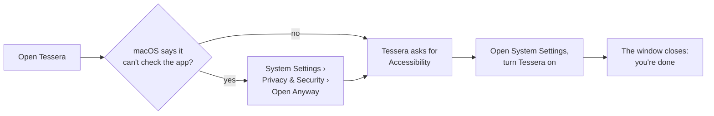
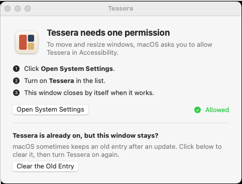
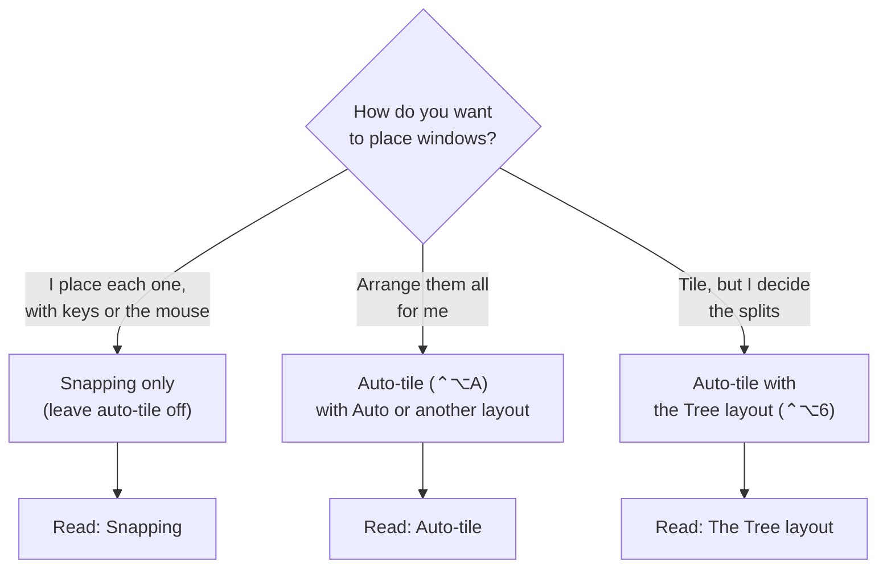
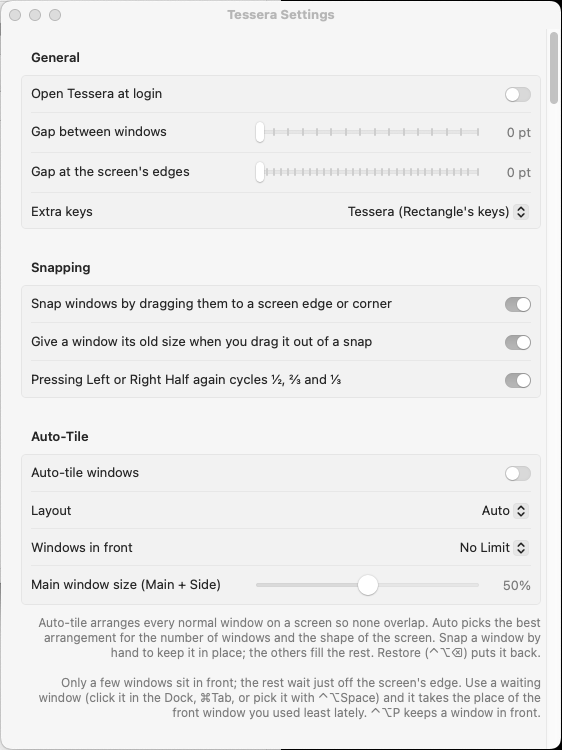

# Getting started

Install Tessera, give it one permission, and try the five things below. It takes about five minutes.

You need macOS 15 or later, on an Apple silicon or Intel Mac.

## 1. Install

**With Homebrew** (this also installs the `tessera` command line tool):

```bash
brew tap vik101/tessera https://github.com/vik101/Tessera
brew install --cask vik101/tessera/tessera
```

**Or by hand:** download `Tessera.zip` from the [latest release](https://github.com/vik101/Tessera/releases/latest), unzip it, and drag **Tessera** into **Applications**.

## 2. Open it and allow Accessibility



1. **Open Tessera.** If you downloaded it by hand, macOS may say it can't check the app, because Apple hasn't checked it (it isn't notarized). Open **System Settings › Privacy & Security**, scroll down, and click **Open Anyway**. Homebrew installs skip this step.
2. **Allow Accessibility.** This is how every window manager moves windows. Tessera shows this window. Click **Open System Settings** and turn Tessera on. The window closes by itself once it works.

<p align="center"></p>

3. **If Rectangle is running,** Tessera offers to quit it. Both use the same keys, so only one can answer.
4. **macOS 15's own edge tiling** fights Tessera's. Tessera asks once to turn it off. You can also do it yourself: **System Settings › Desktop & Dock › Drag windows to screen edges to tile**.

Tessera now lives in the menu bar. Its icon opens every action, the layouts and **Settings…** (⌘,).

## 3. Try these five things

| Try | What happens |
| --- | --- |
| Press **⌃⌥←** | The window you're in fills the left half. Press it again for ⅔, then ⅓. |
| Drag a window to the right edge | A blue outline shows the right half. Let go to snap. |
| Press **⌃⌥A** | Auto-tile turns on. Every window on the screen gets its own space. |
| Press **⌃⌥2**, then **⌃⌥1** | Columns, then back to Auto, which picks the best layout for you. |
| Press **⌃⌥Space** | A list of every window on this desktop. Press a number to bring one forward. |

⌃ is Control and ⌥ is Option. [Every shortcut](shortcuts.md) is in one table.

## 4. Pick your style



- [Snapping](snapping.md): keys and drag areas, like Rectangle.
- [Auto-tile](auto-tile.md): eight layouts, and how Tessera keeps a busy screen calm.
- [The Tree layout](tree.md): split windows by hand, like AeroSpace and i3.

## 5. Optional extras

- **Command line tool**, for scripts and AI agents. Homebrew installed it already. Otherwise: menu › **Config and Command Line › Install Command Line Tool…**. Then run `tessera help`. See [Command line tool](cli.md).
- **Config file**, for your own keys, binding modes and window rules: menu › **Config and Command Line › Make a Config File**. See [Config file](config.md).
- **Open at login:** **Settings › General › Open Tessera at login**.

<p align="center"></p>

Settings is one page: General, Snapping, Auto-Tile, Focus and Look, Config File and Command Line, Apps Tessera leaves alone, Setups, App Rules, Keyboard Shortcuts, and More (export and import).

## Updates

If the menu shows **Check for Updates…**, Tessera updates itself: it checks once a day and asks before installing. Otherwise, update with `brew reinstall --cask vik101/tessera/tessera` (the cask always fetches the newest release), or download the new zip from [Releases](https://github.com/vik101/Tessera/releases). [What's new](../CHANGELOG.md) lists every version.

---

[Docs home](README.md) · Next: [Snapping](snapping.md)
