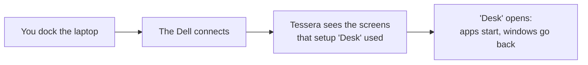

# Rules and setups

Rules tell Tessera what to do with certain windows, every time. Setups save a whole arrangement of apps and windows, to open again in one step.

## App rules

An app rule covers every window of one app. Set one from the menu (**Rules for Safari ▸**, for the app in front) or in **Settings › App Rules**.

| Rule | What it does |
| --- | --- |
| Always Float | Auto-tile leaves the app's windows where you put them. Snapping still works. |
| Always Keep in Front | The app's windows never step back to wait, while at least one front spot stays free |
| New Windows Open On | The app's new windows move to that screen as they open |

To keep Tessera away from an app altogether (no snapping, no tiling), add it to **Settings › Apps Tessera leaves alone**, or click **Ignore** for it in the menu.

## Window rules

Window rules live in the [config file](config.md). They match windows by app, name or title, and run any [command](commands.md) when such a window opens. They use AeroSpace's `on-window-detected` format, so AeroSpace rules work as they are.

```toml
[[on-window-detected]]              # Calculator floats
if.app-id = 'com.apple.calculator'
run = 'layout floating'

[[on-window-detected]]              # Notes windows never wait off screen
if.app-id = 'com.apple.Notes'
run = 'keep on'

[[on-window-detected]]              # any window titled "Picture in Picture" floats
if.window-title-regex-substring = 'picture in picture'
run = ['layout floating', 'keep on']
```

| Condition | Matches |
| --- | --- |
| `if.app-id` | The app's bundle id, exactly (`tessera list-apps` shows them) |
| `if.app-name-regex-substring` | Part of the app's name, as a regular expression, any case |
| `if.window-title-regex-substring` | Part of the window's title, as a regular expression, any case |
| `if.desktop` (or `if.workspace`) | The desktop number the window opens on |
| `if.during-startup` | `true`: only windows already open when Tessera starts; `false`: only new ones |

All the conditions in one rule must match. The first matching rule wins, unless it sets `check-further-callbacks = true`. A rule runs once per window.

## Setups

A setup remembers which apps are on your screens and where their windows are.

| To | Do this |
| --- | --- |
| Save one | Menu › **Setups › Save Current Setup…**, or `tessera setup save Work` |
| Open one | Menu › **Setups**, **⌃⌥⌘1–9** (by its place in the list), or `tessera setup open Work` |
| Rename, delete, or change one | **Settings › Setups** |

**Opening a setup** starts any of its apps that aren't running, puts each window back on its screen and in its place, and gives each screen the layout it had. It also hides the apps that aren't in it (they keep running); switch that off for a setup with **Hide other apps**. Places are saved as shares of the screen, so a setup also works on a screen of another size.

### Opening a setup by itself



- **When its screens connect:** in **Settings › Setups**, turn on **Open when its screens connect**. Plugging in a screen the setup uses then opens it.
- **When a Focus turns on, an app opens, or at a set time:** make an automation in the **Shortcuts** app. Use the **Run Shell Script** action with `tessera setup open Work`, or the **Open URLs** action with `tessera://open-setup?name=Work`.

---

[Docs home](README.md) · Back: [Desktops and screens](desktops-and-screens.md) · Next: [Config file](config.md)
