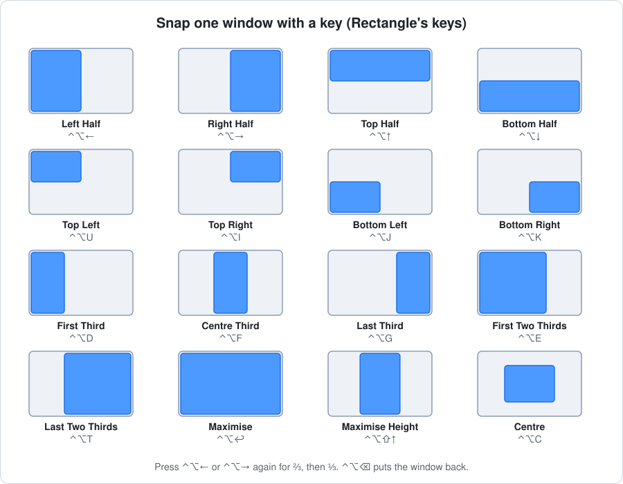
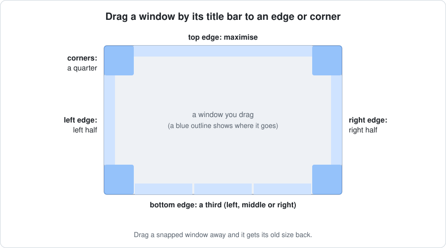
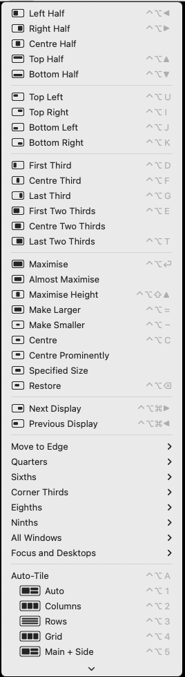

# Snapping

Snapping puts one window in one part of the screen: a half, a third, a corner, the middle. It works with keys or by dragging, exactly like Rectangle, and it works whether auto-tile is on or off.

## With keys

- **Press a half again** (⌃⌥← or ⌃⌥→) and the window cycles through ½, ⅔ and ⅓ of the screen. The corners cycle too. Turn this off in **Settings › Snapping**.
- **⌃⌥⌫ (Restore)** gives the window the size and place it had before you snapped it.
- **⌃⌥= and ⌃⌥−** make the window larger or smaller, on every side that isn't against a screen edge.
- **⌃⌥⌘→ and ⌃⌥⌘←** move the window to the next or previous screen, at the same share of it. A snapped window keeps its snap: Left Half stays Left Half.
- On a portrait screen, thirds and quarters run top to bottom, like Rectangle.

Change any key in **Settings › Keyboard Shortcuts**: click it and press new keys. Esc cancels; Delete removes it.

## With the mouse

Drag a window by its title bar. A blue outline shows where it will land; let go to snap. Turn this off in **Settings › Snapping**.

To drag a window from **anywhere** inside it, not only its title bar, hold **fn** while you drag. Change that key in **Settings › Focus and Look**.

## More places, from the menu

These have no key yet. They are in the menu (in submenus such as **Quarters** and **Ninths**), and you can give any of them a key in Settings:

| Group | Places |
| --- | --- |
| Halves and thirds | Centre Half, Centre Two Thirds |
| Size | Almost Maximise, Centre Prominently (centred, a little high), Specified Size (1680 × 1050 points unless you change it in Settings) |
| Move to Edge | Move Left, Right, Up, Down (keeps the size) |
| Quarters | First, Second, Third, Last Quarter; First, Centre, Last Three Quarters |
| Sixths | Top and Bottom: Left, Centre, Right |
| Corner Thirds | Two thirds wide, half high, in each corner |
| Eighths, Ninths | Every eighth and ninth of the screen |

With these, Tessera has every single-window action in Rectangle's free version. Scripts can run any of them by name: see [Snap names](commands.md#snap-names).

## Every window at once

The menu's **All Windows** list moves every window on the screen you're working on.

| Action | What it does | With auto-tile on |
| --- | --- | --- |
| Tile All | A near-square grid; the last row has fewer, wider windows | Picks Grid |
| Tile in Rows / Columns | Up to 3 rows (or columns); more windows share them | Picks Rows / Columns |
| Cascade All / This App | Each window 30 points down and right of the one behind | Not available: it would undo the tiles |
| Reverse All | Mirrors every window left to right | Reverses the order of the tiles |
| Next / Previous Stacked Window | Brings forward the next window sitting on the same spot | Works on windows you snapped to one spot |

## Snapping with auto-tile on

The two work together. **A window you snap by hand keeps its spot**, and the other windows tile in the rest of the screen. The next layout you pick puts it back in the layout. [Auto-tile](auto-tile.md#snapping-a-tiled-window) explains this.

With auto-tile on, ⌃⌥ + an arrow key **walks** a tiled window through the layout instead of snapping it to a half. To snap it to a half, use the menu or `tessera place left`.

## Apps Tessera leaves alone

**Settings › Apps Tessera leaves alone** lists apps whose windows Tessera never snaps or tiles. System Settings and Calculator are there to start with. Add an app with **Add App…**, or from the menu.

---

[Docs home](README.md) · Back: [Getting started](getting-started.md) · Next: [Auto-tile](auto-tile.md)
