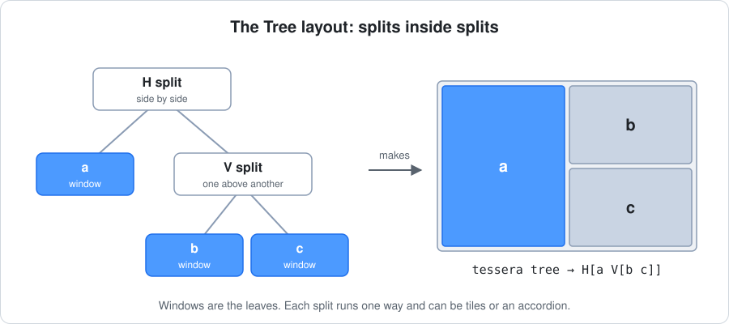
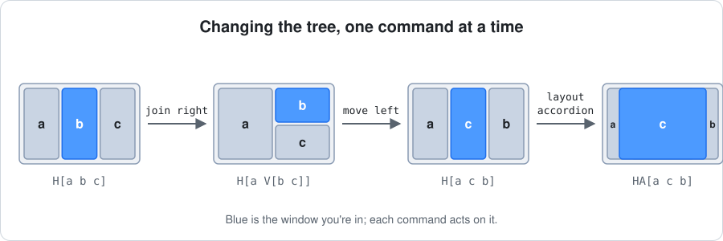

# The Tree layout

In the Tree layout you decide how windows split the screen, like in AeroSpace and i3. Press **⌃⌥6** (or run `tessera layout tree`) to use it on the desktop you're on.

<p align="center"></p>

## How it works

- **Each desktop is a tree.** Windows are the leaves. Every other node is a **split** that holds windows or more splits.
- **A split runs one way:** H (side by side) or V (one above another).
- **A split has a style:** tiles (each child gets a share) or **accordion** (each child fills the split, with a strip of its neighbours showing).
- **Tessera keeps the tree tidy.** A split left with one window disappears, and a split inside a split that runs the same way merges into it.
- **Switching to Tree moves nothing.** Tessera reads the tree from where your windows already are.

`tessera tree` prints each screen's tree as text: `H[1234 V[5678 9012]]`. The numbers are window ids. `HA[…]` and `VA[…]` are accordion splits.

## New windows

A new window splits the window you used last, along its longer side. To choose the side, run `preselect` first:

```bash
tessera preselect down     # the next new window opens below this one
```

The first split on an empty desktop runs side by side on a wide screen and top to bottom on a tall one. The config file can change that with `default-root-container-orientation`.

## Changing the tree

<p align="center"></p>

Every command acts on the window you're in (or on `--window-id ID`).

| Command | What it does |
| --- | --- |
| `focus left` (right, up, down) | Focus the window that way |
| `move left` | Move the window that way: past its neighbour, or out of its split at the edge. Past the screen's edge it goes to the next screen. |
| `swap left`, `swap next` | Trade places with that window |
| `join left` | Put this window and the one that way into a new split of their own |
| `split`, `split vertical` | With no way: turn this window's split the other way. With one: the next window opens that way. |
| `preselect down` | The next new window opens on that side of this one |
| `layout tiles`, `layout accordion` | Change the style of this window's split |
| `layout horizontal`, `layout vertical` | Change the way this window's split runs |
| `resize width +100`, `resize smart -50` | Grow or shrink this window's tile; its neighbours share the change |
| `border horizontal 100` | Move one edge of the tile; only the neighbour on that side gives way |
| `balance` | Give every tile an even share |
| `flatten` | Undo every split: all windows side by side again |
| `mirror horizontal`, `rotate 90` | Flip or turn the whole tree |
| `pop out`, `pop in` | Take the window out of its split, or into its neighbour's |
| `zoom` | The window fills the desktop. Run it again to put it back. |
| `float on`, `float off` | Take the window out of the tree, and back into its old spot |

The [command reference](commands.md#the-tree-layout) has every option. To give these keys, use the `aerospace` preset or your own bindings in the [config file](config.md#key-bindings-and-modes):

```toml
preset = 'aerospace'          # alt-h/j/k/l focus, alt-shift-h/j/k/l move, alt-1…9 desktops

[mode.main.binding]
alt-shift-ctrl-h = 'join left'
alt-shift-ctrl-l = 'join right'
alt-z = 'zoom'
```

## With the mouse

| Drop a window… | And it… |
| --- | --- |
| On the **middle** of another window | Swaps with it |
| Near another window's **edge** | Splits that window and sits on that side of it |
| Anywhere, holding **fn** | Moves from wherever you grabbed it, not only by its title bar |

Drag the edge between two tiles to resize them. Only the tile on the other side of that edge gives way.

## Windows that come back

A window you minimise or float leaves a note of where it was. When it comes back (you un-minimise it, or run `float off`), it returns to the same spot, beside the same neighbours. A window coming back from macOS full screen rejoins the tree too. A window you close is gone for good: its neighbours take its space.

## Tree, Stack and Float together

Each desktop has its own layout, so you can keep Tree on one desktop and Auto on another. Switching a desktop from Tree to Stack or Float and back keeps its tree as it was.

---

[Docs home](README.md) · Back: [Auto-tile](auto-tile.md) · Next: [Desktops and screens](desktops-and-screens.md)
